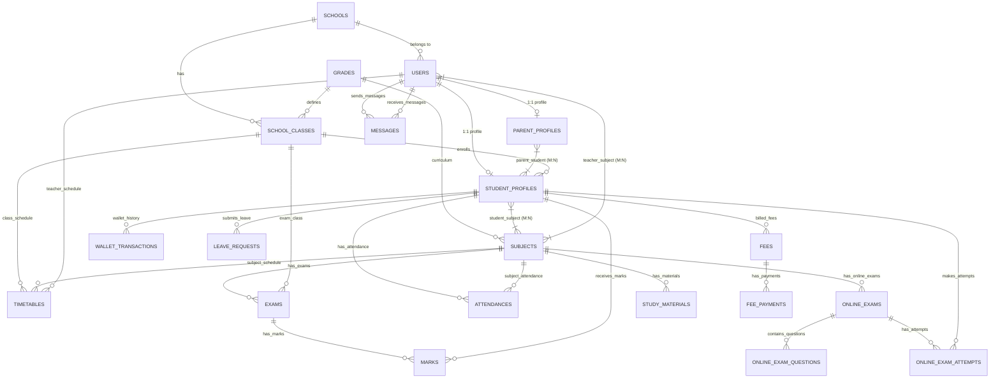
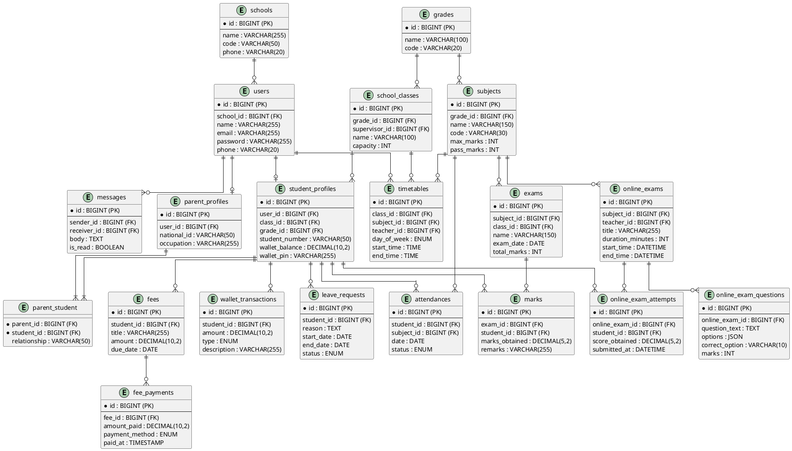

<div dir="rtl">

# جامعة طرابلس
## كلية العلوم
### قسم الحاسب الآلي

<br><br>

<h3 align="center">عنوان المشروع</h3>
<h1 align="center">المدرسة الذكية (Smart School)</h1>
<h3 align="center">(نظام متكامل لإدارة المدارس التعليمية وشؤون الطلاب)</h3>

<br>

<h4 align="center">مشروع مقدم كجزء من متطلبات الحصول على درجة البكالوريوس في علوم الحاسب الآلي</h4>

<br><br>

**إعداد الطلبة:**
* محمد محمود عبد السلام بريكة
* محمد مفتاح سعد بوجناح

<br>

**إشراف:**
* د. أميمة الشلي

<br>

**السنة الأكاديمية:**
ربيعي 2025/2026

<div style="page-break-after: always;"></div>

# الإهداء

بسم الله الرحمن الرحيم

﴿يَرْفَعِ اللَّهُ الَّذِينَ آمَنُوا مِنكُمْ وَالَّذِينَ أُوتُوا الْعِلْمَ دَرَجَاتٍ﴾

نهدي هذا الجهد المتواضع إلى والدينا الكريمين، الذين كانوا لنا السند والعون، وبذلوا من أجلنا الكثير، فكان دعمهم رفيق دربنا في كل خطوة من خطوات حياتنا.

إلى أساتذتنا الأفاضل الذين أناروا لنا طريق المعرفة.

وإلى كل من ساهم في إنجاح هذا العمل.

<div style="page-break-after: always;"></div>

# الملخص

يهدف مشروع "المدرسة الذكية (Smart School)" إلى تصميم وتطوير منصة برمجية متكاملة لإدارة المدارس التعليمية وتسهيل العمليات الإدارية والأكاديمية. جاء المشروع لمعالجة التحديات التي تواجه الإدارة المدرسية التقليدية في السوق المحلي، والتي تعتمد غالباً على العمليات اليدوية أو الأنظمة غير المترابطة، مما يؤدي إلى صعوبة في تنظيم بيانات الطلاب، ومتابعة الحضور والانصراف، وإدارة الامتحانات والمصروفات، بالإضافة إلى ضعف التواصل بين المدرسة وأولياء الأمور.

يوفر النظام أدوات متكاملة لإدارة النظام المدرسي بكفاءة عالية، بما في ذلك إدارة شؤون الطلاب، الفصول الدراسية، المواد، الامتحانات والجداول الدراسية. كما يتيح لأولياء الأمور متابعة أداء أبنائهم الأكاديمي، وسجل حضورهم، وسداد الرسوم المدرسية إلكترونياً.

يتضمن المشروع أيضاً لوحات تحكم مخصصة لمدير النظام (Admin) لإدارة كافة الأقسام، وللمعلمين لمتابعة وتقييم الطلاب وإدارة المحتوى الأكاديمي. تم تطوير النظام باستخدام أحدث تقنيات الويب، مع تطبيق منهجية مرنة تجمع بين التخطيط المسبق والتطوير التكراري، مما يحقق المرونة وسهولة الصيانة والتوسع مستقبلاً.

<div style="page-break-after: always;"></div>

# فهرس المحتويات

1. **الفصل الأول: مرحلة التواصل والتخطيط**
   - 1.1 نبذة عن المشروع
   - 1.2 هدف المشروع
   - 1.3 الوضع الحالي
   - 1.4 الابتكار في المشروع
   - 1.5 تأثير المشروع
   - 1.6 تحليل المخاطر
   - 1.7 خطة المشروع
2. **الفصل الثاني: مرحلة تحليل المتطلبات**
   - 2.1 مقدمة
   - 2.2 جمع المتطلبات
   - 2.3 المتطلبات الوظيفية
     - 2.3.1 متطلبات مدير النظام (Admin)
     - 2.3.2 متطلبات المعلم (Teacher)
     - 2.3.3 متطلبات الطالب (Student)
     - 2.3.4 متطلبات ولي الأمر (Parent)
   - 2.4 المتطلبات غير الوظيفية
   - 2.5 مخطط حالات الاستخدام (Use Case Diagram)
3. **الفصل الثالث: مرحلة التصميم**
   - 3.1 مقدمة
   - 3.2 مخطط علاقات الكيانات (ERD)
   - 3.3 وصف كيانات النظام
   - 3.4 وصف العلاقات بين الكيانات
4. **الفصل الرابع: مرحلة التنفيذ والاختبار**
   - 4.1 تنفيذ النظام
   - 4.2 اللغات والأدوات المستخدمة
   - 4.3 واجهات النظام
   - 4.4 اختبار النظام
5. **المراجع**
6. **الخاتمة**

<div style="page-break-after: always;"></div>

</div>

<div style="page-break-after: always;"></div>

# الفصل الأول: مرحلة التواصل والتخطيط

## 1.1 نبذة عن المشروع
تعاني العديد من المدارس والمؤسسات التعليمية في ليبيا من تحديات واضحة، حيث يعتمد الكثير منها على الإدارة الورقية أو أنظمة غير مترابطة، مما يؤدي إلى غياب التنظيم وصعوبة إدارة شؤون الطلاب وتتبع الأداء الأكاديمي. بالإضافة إلى ذلك، تفتقر العديد من المدارس إلى وسيلة فعالة للتواصل مع أولياء الأمور بشكل مباشر ومستمر. 
يهدف مشروع "المدرسة الذكية (Smart School)" إلى معالجة هذه التحديات من خلال توفير منصة متكاملة تمكّن الإدارة من تنظيم كافة العمليات المدرسية بسهولة، بدءاً من تسجيل الطلاب وإدارة الجداول، وصولاً إلى متابعة الحضور والغياب، وإدارة الامتحانات، وتسديد الرسوم المدرسية. كما يتيح النظام للمعلمين وأولياء الأمور بيئة تفاعلية منظمة وفعالة.

## 1.2 هدف المشروع
يهدف مشروع المدرسة الذكية إلى معالجة المشاكل الشائعة في الإدارة المدرسية المحلية، حيث تضطر الإدارة إلى استهلاك وقت طويل في إعداد التقارير ومتابعة الحضور يدوياً، مما يزيد من احتمالية الأخطاء البشرية.
تسعى المنصة إلى توفير بيئة تعليمية وإدارية رقمية، مع تقديم أدوات متطورة لكل من الإدارة، المعلمين، الطلاب، وأولياء الأمور.
كما يهدف المشروع إلى تحسين تجربة ولي الأمر من خلال توفير بوابة مخصصة تتيح له متابعة أبنائه بسهولة وشفافية في أي وقت ومن أي مكان.

## 1.3 الوضع الحالي
### 1.3.1 الإدارة التقليدية (الورقية)
تعتمد العديد من المدارس المحلية على الدفاتر الورقية أو جداول Excel البسيطة لتسجيل بيانات الطلاب ودرجاتهم.
**العيوب (Limitations):**
* صعوبة البحث والوصول إلى معلومات طالب معين بسرعة.
* غياب نظام منظم لإدارة المدفوعات والرسوم المدرسية.
* عدم توفر تقارير أكاديمية أو إدارية سريعة.

### 1.3.2 ضعف التواصل مع أولياء الأمور
يقتصر التواصل في الوقت الحالي على المكالمات الهاتفية أو الزيارات الشخصية، أو استخدام مجموعات التواصل الاجتماعي (مثل WhatsApp) بشكل عشوائي.
**العيوب (Limitations):**
* عدم قدرة ولي الأمر على متابعة الحضور والغياب اليومي بشكل لحظي.
* صعوبة معرفة الجداول الدراسية أو الواجبات المنزلية بدقة.

## 1.4 الابتكار في المشروع
على الرغم من وجود أنظمة عالمية لإدارة المدارس، إلا أن الكثير منها لا يتناسب مع متطلبات المدارس المحلية من ناحية سياسات الدفع، واللغة، وسهولة الاستخدام. ينطلق مشروع المدرسة الذكية من مبدأ توفير منصة مخصصة للسوق المحلي، تراعي الاحتياجات الخاصة بالمدارس، وتقدم دعماً كاملاً للغة العربية، مع واجهات سهلة الاستخدام تناسب كافة فئات المستخدمين، بالإضافة إلى نظام محافظ إلكترونية (Wallets) متكامل لإدارة المصروفات المدرسية.

## 1.5 تأثير المشروع
يستهدف هذا المشروع عدة فئات رئيسية تشمل الإدارة، المعلمين، الطلاب، وأولياء الأمور. حيث يساهم النظام في تمكين الإدارة من إدارة المدرسة بشكل منظم وفعال. كما يوفر لأولياء الأمور تجربة مريحة من خلال إمكانية استعراض درجات أبنائهم، ومتابعة الحضور، والتواصل مع الإدارة أو المعلمين دون الحاجة لزيارة المدرسة بشكل متكرر. وعلى مستوى السوق المحلي، يساهم المشروع في دعم التحول الرقمي في قطاع التعليم.

## 1.6 تحليل المخاطر
### 1.6.1 مخاطر المنتج
**1. المشكلة:** قد يواجه النظام انخفاضاً في الأداء عند زيادة عدد المستخدمين (طلاب، معلمين، أولياء أمور) خاصة في فترات إعلان النتائج، مما يؤدي إلى بطء في الاستجابة.
* **Reduce (التقليل):** تحسين أداء النظام من خلال تقليل عدد الاستعلامات (Queries) واستخدام تقنيات التخزين المؤقت (Caching).
* **Mitigate (التخفيف):** إمكانية رفع مواصفات الخادم الأساسي وتوزيع الأحمال.

**2. المشكلة:** اختراق حسابات الإدارة أو التلاعب في درجات الامتحانات والبيانات المالية.
* **Reduce (التقليل):** تقييد صلاحيات تعديل الدرجات لتكون محصورة بمعلم المادة ومدير النظام، وتطبيق آليات أمان وتشفير قوية.
* **Mitigate (التخفيف):** اعتماد نظام تدقيق (Audit Trail) لتسجيل كافة الإجراءات التي يقوم بها المستخدمون، ومتابعة التغييرات.

### 1.6.2 مخاطر المشروع
**1. المشكلة:** ضيق الوقت مقارنة بحجم المشروع وتعدد وحداته (طلاب، مالية، امتحانات).
* **Reduce (التقليل):** تحديد نطاق المشروع (Scope) بشكل واضح، والتركيز على الوظائف الأساسية (Core Features) لتجنب إضافة ميزات غير ضرورية.
* **Mitigate (التخفيف):** تقسيم المهام بين عضوي الفريق بشكل متوازن، وتطبيق نظام تطوير متكرر يضمن تسليم وظائف تعمل بالكامل في كل دورة.

## 1.7 خطة المشروع
### 1.7.1 المنهجية المتبعة
يعتمد المشروع على منهجية هجينة (Hybrid Model) تجمع بين منهجية Waterfall ومنهجية Agile Scrum. تم استخدام Waterfall في المراحل الأولى للتخطيط وجمع المتطلبات لتحديد الوظائف الأساسية بوضوح. بعد ذلك، تم اعتماد Agile Scrum خلال مرحلة التنفيذ لتطوير أجزاء النظام (مثل وحدة المستخدمين، وحدة المالية، وحدة الامتحانات) عبر دورات تطوير قصيرة (Sprints).

### 1.7.2 قيود المشروع
* **قيد الوقت:** آخر موعد لتسليم المشروع بنهاية الفصل الربيعي 2025/2026.
* **قيد الفريق:** يتم تطوير المشروع بواسطة فريق مكوّن من طالبين فقط، مما يحد من سرعة الإنجاز مقارنة بالفرق الكبيرة.

### 1.7.3 تقدير أنشطة المشروع
تم تقدير مدة الأنشطة بناءً على الخبرة السابقة في التطوير وتحليل الأنظمة المتوفرة. وتم توزيع المهام بشكل عملي يتناسب مع قدرات الفريق.

### 1.7.4 المعالم الرئيسية للمشروع
* تحديد وتحليل متطلبات النظام (System Requirements Definition).
* إعداد تصميم مبدئي عالي المستوى للنظام (High-level System Design).
* تنفيذ مجموعة من دورات التطوير (Sprints) بشكل دوري.
* الانتهاء من اختبار النظام بشكل كامل (System Testing Completed).
* تسليم النسخة النهائية من المشروع (Final Version Delivered).

### 1.7.5 مخرجات المشروع
* تطبيق ويب متكامل لإدارة المدرسة الذكية.
* كود المشروع (Source Code).
* تقرير المشروع (Project Report - هذا المستند).
* عرض تقديمي (Presentation).

</div>

<div style="page-break-after: always;"></div>

# الفصل الثاني: مرحلة تحليل المتطلبات

## 2.1 مقدمة
تعتبر مرحلة نمذجة المتطلبات المرحلة التي يتم فيها رسم ملامح النظام، بحيث يتم فيها تحديد وتحليل الوظائف التي يتوقع توفيرها في النظام المقترح. وسيستعرض هذا الفصل الطرق التي تم استخدامها في جمع متطلبات النظام، واستخراج المعلومات التي تساعد في تحديد المتطلبات، وتصنيف هذه المتطلبات إلى متطلبات وظيفية (Functional Requirements) وغير وظيفية (Non-Functional Requirements)، ونمذجة المتطلبات الوظيفية باستخدام مخطط حالة الاستخدام (UCD) الذي يصف تفاعل النظام مع المستخدمين.

## 2.2 جمع المتطلبات
يساعد جمع المتطلبات على فهم وتحليل وتحديد حلول لمشاكل الأنظمة الحالية، وتحديد الوظائف التي يجب أن تتوفر في النظام المقترح. ومن أبرز الطرق التي تم استخدامها:

### 2.2.1 دراسة الأنظمة المشابهة
تم الاطلاع على أنظمة إدارة مدرسية مشابهة محلية وعالمية، ومعرفة طريقة عملها والوظائف الأساسية التي توفرها. وقد تم تجميع هذه المعلومات للاستفادة من آلية عملها وأفضل الممارسات المستخدمة فيها لمعالجة الخلل في النظام الورقي المتبع.

### 2.2.2 المقابلة الشخصية
تم إجراء مقابلة ومناقشة مع أطراف مختلفة (مدراء مدارس، معلمين، أولياء أمور) بهدف التعرف على احتياجاتهم والمشاكل التي يواجهونها في الإدارة والتواصل والمتابعة الأكاديمية، مما ساعد في إعطاء تصور واقعي للمتطلبات وبناء نظام يلبي تطلعات البيئة التعليمية الليبية.

## 2.3 المتطلبات الوظيفية

### 2.3.1 متطلبات مدير النظام (Admin)

تُمثل متطلبات مدير النظام (Admin / Super Admin) العصب المركزي لمنصة "المدرسة الذكية"، حيث تم التخطيط لبناء وحدات متكاملة تضمن السيطرة الإدارية، التنظيم الأكاديمي، والرقابة المالية الشاملة. تتلخص حالات الاستخدام الخاصة بمدير النظام في 12 حالة استخدام تفصيلية كما يلي:

#### 1. إدارة المستخدمين والأدوار

يتيح النظام لمدير النظام إدارة كافة حسابات المستخدِمين من مكان موحّد، وتشمل: المعلمين، الطلاب، وأولياء الأمور، بالإضافة لإنشاء مدراء فرعيين وتحديد الأدوار والصلاحيات (Roles & Permissions) عبر نظام Spatie المتقدم.

| الحقل | التفصيل |
|---|---|
| **اسم حالة الاستخدام** | إدارة المستخدمين والأدوار (Manage Users & Roles) |
| **المعرّف** | UC-01 |
| **الممثل (Actor)** | مدير النظام (Admin) |
| **الوصف** | يقوم المدير بإنشاء حسابات المستخدمين الجديدة، تعديل بياناتها، تجميدها مؤقتاً أو حذفها، وتعيين الصلاحيات الخاصة بكل دور في النظام. |
| **الشرط المسبق** | تسجيل الدخول بصفة مدير النظام (Admin). |
| **التدفق الرئيسي** | 1. يدخل المدير لقسم إدارة المستخدمين.<br>2. يختار نوع الحساب (معلم، طالب، ولي أمر، مدير دراسة).<br>3. يدخل البيانات الأساسية والصلاحيات المطلوبة.<br>4. يحفظ التغييرات في النظام. |
| **الشرط اللاحق** | يتم إنشاء وتحديث حساب المستخدم في قاعدة البيانات وتفعيل أدواته فوراً. |

#### 2. إدارة الهيكل المدرسي والفصول

يمكّن النظام المدير من بناء وتحديد الهيكل التنظيمي للمدرسة، ويشمل ذلك تعريف المراحل الدراسية (Grades)، الفصول والشُعب (School Classes)، تحديد الطاقة الاستيعابية لكل فصل، وتعيين المعلم المشرف.

| الحقل | التفصيل |
|---|---|
| **اسم حالة الاستخدام** | إدارة الهيكل المدرسي (Manage School Structure) |
| **المعرّف** | UC-02 |
| **الممثل (Actor)** | مدير النظام (Admin) |
| **الوصف** | ينشئ المدير المراحل الدراسية والفصول، يحدد السعة الاستيعابية لكل قاعة، ويخصص معلم مشرف لكل فصل. |
| **الشرط المسبق** | تسجيل دخول مدير النظام للمدرسة المعنية. |
| **التدفق الرئيسي** | 1. يدخل المدير إلى وحدة هيكل المدرسة.<br>2. ينشئ مرحلة دراسية أو يضيف فصلاً دراسياً جديداً.<br>3. يحدد الطاقة الاستيعابية والمعلم المشرف.<br>4. يحفظ بيانات الفصل. |
| **الشرط اللاحق** | يصبح الفصل جاهزاً لتسكين الطلاب وإسناد المواد والجداول. |

#### 3. إدارة المواد الدراسية وتوزيع الدرجات

يتيح النظام للمدير تعريف المناهج والمواد الدراسية المقررة لكل مرحلة دراسية، تحديد رموز المواد، وضبط الدرجة العظمى ودرجة النجاح، وتوزيع أوزان الدرجات (أعمال السنة، الامتحانات النصفية والنهائية).

| الحقل | التفصيل |
|---|---|
| **اسم حالة الاستخدام** | إدارة المواد وتوزيع الدرجات (Manage Subjects & Grade Distribution) |
| **المعرّف** | UC-03 |
| **الممثل (Actor)** | مدير النظام (Admin) |
| **الوصف** | يضيف المدير المواد الدراسية، يحدد معايير النجاح والرسوب، ويضبط توزيع الدرجات لكل مادة حسب اللائحة المدرسية. |
| **الشرط المسبق** | تعريف المراحل الدراسية مسبقاً في النظام. |
| **التدفق الرئيسي** | 1. يدخل المدير لصفحة إدارة المواد.<br>2. يضيف مادة جديدة ويربطها بالمرحلة الاستهدافية.<br>3. يحدد الدرجة العظمى ودرجة النجاح وتوزيع التقييمات.<br>4. يحفظ بيانات المادة. |
| **الشرط اللاحق** | إتاحة المادة في خطة التقييم وجعلها قابلة للتكليف والرصد. |

#### 4. إسناد المواد للمعلمين

يوفر النظام واجهة تفاعلية تُتيح لمدير النظام توزيع وتكليف المعلمين بتدريس المواد الدراسية للفصول والشعب المختلفة، مع إمكانية تعديل أو إلغاء الإسناد والتحقق من عدم وجود تضارب في العبء التدريسي.

| الحقل | التفصيل |
|---|---|
| **اسم حالة الاستخدام** | إسناد المواد للمعلمين (Teacher Subject Assignment) |
| **المعرّف** | UC-04 |
| **الممثل (Actor)** | مدير النظام (Admin) |
| **الوصف** | يقوم المدير بتكليف معلم محدد بتدريس مادة معينة لشعبة أو فصل محدد، وتحديث قائمة المعلمين المسؤولين. |
| **الشرط المسبق** | وجود حسابات المعلمين والفصول والمواد معرفة مسبقاً. |
| **التدفق الرئيسي** | 1. يدخل المدير لصفحة توزيع المواد.<br>2. يختار الفصل والمادة ثم يحدد المعلم المكلف.<br>3. يتحقق النظام من الصلاحيات والعبء التدريسي.<br>4. تؤكد عملية الإسناد. |
| **الشرط اللاحق** | تمكين المعلم المخصص من الوصول لطلاب الفصل ورصد درجاتهم وحضورهم. |

#### 5. إدارة قبول الطلاب والتسكين

يتيح النظام للمدير استقبال ومراجعة طلبات الالتحاق الإلكترونية المقدمة من المستجدين، اتخاذ قرار القبول أو الرفض، وتسكين الطلاب غير الموزعين في الفصول المناسبة بشكل آلي أو يدوي.

| الحقل | التفصيل |
|---|---|
| **اسم حالة الاستخدام** | إدارة قبول الطلاب والتسكين (Manage Admissions & Unassigned Students) |
| **المعرّف** | UC-05 |
| **الممثل (Actor)** | مدير النظام (Admin) |
| **الوصف** | يفحص المدير طلبات التسجيل الإلكتروني، يعتمد ملفات القبول، ويحدد الفصول الدراسية للطلاب الجدد غير الموزعين. |
| **الشرط المسبق** | وجود طلبات التسجيل في قائمة الانتظار. |
| **التدفق الرئيسي** | 1. يدخل المدير لوحدة القبول والتسجيل.<br>2. يراجع بيانات ومستندات الطالب المستجد.<br>3. يوافق على الطلب ويحدد الفصل والمرحلة للتسكين.<br>4. يُولد النظام رقم الطالب الأكاديمي ويحفظ البيانات. |
| **الشرط اللاحق** | اعتماد الطالب رسمياً وإصدار الرقم الأكاديمي وتخصيص الفصل. |

#### 6. ربط أولياء الأمور بالأبناء

يمكّن النظام المدير من إنشاء وتحديث علاقات التبعية الإشرافية بين حسابات أولياء الأمور وأبنائهم الطلاب، بما يضمن اطلاع ولي الأمر على بيانات جميع أبنائه عبر حساب واحد.

| الحقل | التفصيل |
|---|---|
| **اسم حالة الاستخدام** | ربط أولياء الأمور بالأبناء (Link Parents & Students) |
| **المعرّف** | UC-06 |
| **الممثل (Actor)** | مدير النظام (Admin) |
| **الوصف** | يربط المدير حساب ولي الأمر بالطلاب المنتمين لأسرتك عبر الرقم الوطني أو معرّف ولي الأمر. |
| **الشرط المسبق** | وجود حساب ولي الأمر وحسابات الأبناء مفعّلة في النظام. |
| **التدفق الرئيسي** | 1. يدخل المدير لصفحة ربط الآباء بالأبناء.<br>2. يبحث عن ولي الأمر باستخدام البريد أو الرقم الوطني.<br>3. يحدد الأبناء التابعين له ويؤكد الرابط.<br>4. يحفظ النظام سجل التبعية. |
| **الشرط اللاحق** | ربط ملفات الأبناء ببوابة ولي الأمر الموحدة. |

#### 7. إنشاء وإدارة الجداول الدراسية الآلية

يوفر النظام أداة متطورة للتوليد الآلي للجدول الأسبوعي للفصول والمواد والمعلمين بدون تعارض في الحصص أو القاعات، مع توفير خيارات التعديل اليدوي وتبديل الحصص بين المعلمين.

| الحقل | التفصيل |
|---|---|
| **اسم حالة الاستخدام** | إنشاء وإدارة الجداول (Generate & Manage Class Timetables) |
| **المعرّف** | UC-07 |
| **الممثل (Actor)** | مدير النظام (Admin) |
| **الوصف** | يقوم المدير بتوليد الجداول الدراسية آلياً للفصول مع منع التعارضات، وإمكانية إجراء التبديل الفوري للحصص. |
| **الشرط المسبق** | إكمال إسناد المواد والمعلمين وتحديد أوقات الحصص اليومية. |
| **التدفق الرئيسي** | 1. يدخل المدير لوحدة الجداول الدراسية.<br>2. يضغط على أمر التوليد الآلي للجدول.<br>3. يفحص الخوارزمية التعارضات ويعرض الجدول المقترح.<br>4. يعتمد المدير الجدول النهائي للنشر. |
| **الشرط اللاحق** | نشر الجدول الأسبوعي واستعراضه في بوابات الطلاب والمعلمين. |

#### 8. إدارة الامتحانات والجداول الامتحانية

يمكّن النظام المدير من التخطيط للامتحانات المدرسية والمركزية، إعداد جدول الاختبارات، تحديد تاريخ ووقت كل امتحان، وتوزيع الطلاب والقاعات ولجان المراقبة.

| الحقل | التفصيل |
|---|---|
| **اسم حالة الاستخدام** | إدارة الامتحانات والجداول (Manage Exams & Exam Schedules) |
| **المعرّف** | UC-08 |
| **الممثل (Actor)** | مدير النظام (Admin) |
| **الوصف** | ينشئ المدير مواعيد الامتحانات المركزية، يحدد القاعات والمراقبات، ويصدر جدول الامتحانات الرسمي. |
| **الشرط المسبق** | تعريف الفصول والمواد الدراسية مسبقاً. |
| **التدفق الرئيسي** | 1. يدخل المدير لصفحة الامتحانات المركزية.<br>2. ينشئ جدول امتحان مادة محددة ويزوده بالتاريخ والتوقيت والقاعة.<br>3. يخصص المعلمين المشرفين على اللجان.<br>4. يعتمد وينشر الجدول الامتحاني. |
| **الشرط اللاحق** | إظهار جدول الامتحانات الرسمي لكافة الطلاب المعنيين والمعلمين. |

#### 9. إدارة المالية، الرسوم، والمحافظ الإلكترونية

يوفر النظام وحدة مالية متكاملة تتيح للمدير تعريف الرسوم الدراسية، متابعة التحصيل، تسديد الأقساط وإصدار الإيصلات، شحن المحافظ الإلكترونية للأبناء، وتتبع المصروفات والإيرادات.

| الحقل | التفصيل |
|---|---|
| **اسم حالة الاستخدام** | إدارة المالية والرسوم والمحافظ (Manage Fees, Finance & E-Wallets) |
| **المعرّف** | UC-09 |
| **الممثل (Actor)** | مدير النظام (Admin) |
| **الوصف** | يحدد المدير هيكل الرسوم المدرسية، يسجل المدفوعات، يشحن رصيد المحافظ الإلكترونية، ويسجل المصروفات اليومية. |
| **الشرط المسبق** | تحديد قيمة الرسوم الدراسية المقررة لكل مرحلة. |
| **التدفق الرئيسي** | 1. يدخل المدير إلى قسم المالية والمصروفات.<br>2. يستعرض موقف الرسوم للطلاب والتحصيلات المتأخرة.<br>3. يسجل عملية سداد نقدي أو شحن محفظة إلكترونية.<br>4. يطبع إيصال السداد المالي المعتمد. |
| **الشرط اللاحق** | تحديث سجل مدفوعات الطالب ورصيد المحفظة وإدراج السداد في التقرير المالي. |

#### 10. إدارة طلبات الإجازات والاستئذان

يتيح النظام للمدير استقبال ومراجعة طلبات الإجازات والاستئذان المقدمة من أولياء الأمور نيابة عن الأبناء، أو المعلمين، اتخاذ قرار المبرر أو الرفض وتأكيد الأثر في سجل الغياب.

| الحقل | التفصيل |
|---|---|
| **اسم حالة الاستخدام** | إدارة طلبات الإجازات (Manage Leaves & Absences) |
| **المعرّف** | UC-10 |
| **الممثل (Actor)** | مدير النظام (Admin) |
| **الوصف** | يراجع المدير طلبات الغياب والاستئذان المقدمة الكترونياً من أولياء الأمور، ويقرر قبولها أو رفضها. |
| **الشرط المسبق** | وجود طلب استئذان مقدم في النظام من ولي الأمر. |
| **التدفق الرئيسي** | 1. يدخل المدير إلى قسم إدارة الإجازات.<br>2. يستعرض الطلبات المعلقة والسبب والمرفقات الطبية إن وجدت.<br>3. يختار (موافقة بعذر / رفض).<br>4. يرسل الإشعار لصاحب الطلب. |
| **الشرط اللاحق** | تحويل غياب الطالب إلى غياب بمبرر رسمياً في سجلات الحضور. |

#### 11. إدارة ترفيع الطلاب وإغلاق العام الدراسي

يوفر النظام خاصية الانتقال بين السنوات الأكاديمية، حيث يتم التحقق من مكتملية الدرجات، ترفيع الطلاب الناجحين تلقائياً إلى المراحل التالية، إدارة الطلاب المكملين والراسبين، وإغلاق العام الحالي.

| الحقل | التفصيل |
|---|---|
| **اسم حالة الاستخدام** | ترفيع الطلاب وإغلاق العام (Student Promotion & Year Closure) |
| **المعرّف** | UC-11 |
| **الممثل (Actor)** | مدير النظام (Admin) |
| **الوصف** | يفحص المدير استكمال الدرجات والنتائج، ينفذ أمر ترفيع الناجحين للمراحل التالية، ويغلق السنة الدراسية. |
| **الشرط المسبق** | رصد كامل نتائج الامتحانات واعتماد كشوف الدرجات. |
| **التدفق الرئيسي** | 1. يدخل المدير لوحدة ترفيع الطلاب.<br>2. يطلب النظام إجراء فحص مكتملية رصد الدرجات.<br>3. يعاين قائمة الطلاب المؤهلين للترفيع.<br>4. تؤكد تنفيذ عملية الترفيع وإغلاق العام الدراسي. |
| **الشرط اللاحق** | ترفيع الطلاب وتحديث مستوياتهم الأكاديمية وأرشفة بيانات السنة الماضية. |

#### 12. لوحة التحكم المتقدمة والتقارير والإحصائيات

يوفر النظام لوحة قيادة تحليلية (Advanced Dashboard) للمدير، تعرض مؤشرات أداء لحظية (KPIs) عن نسب الحضور، مستويات الطلاب الأكاديمية، أوائل الطلاب، والموقف المالي للمدرسة.

| الحقل | التفصيل |
|---|---|
| **اسم حالة الاستخدام** | استعراض التقارير والإحصائيات (Advanced Dashboard & Analytics) |
| **المعرّف** | UC-12 |
| **الممثل (Actor)** | مدير النظام (Admin) |
| **الوصف** | يستعرض المدير تقارير شاملة ورسوماً بيانية تفاعلية لمراقبة سير العملية التعليمية والمالية. |
| **الشرط المسبق** | وجود بيانات تشغيلية وأكاديمية مسجلة بالنظام. |
| **التدفق الرئيسي** | 1. يدخل المدير إلى لوحة التحكم التحليلي.<br>2. يختار التقرير المطلوب (تقرير الحضور، الإيرادات، الأداء الأكاديمي).<br>3. يحدد النطاق الزمني والفصول.<br>4. يعاين أو يطبع التقرير المعتمد. |
| **الشرط اللاحق** | تمكين المدير من اتخاذ قرارات مبنية على بيانات دقيقة ولحظية. |

### 2.3.2 متطلبات المعلم (Teacher)

تُمثل بوابات وأدوات المعلم الركيزة الأساسية للعملية التعليمية اليومية في منصة "المدرسة الذكية". تم تصميم وتوسيع متطلبات المعلم لتغطي كافة الأنشطة الأكاديمية، التقييمية، والتفاعلية المطبقة فعلياً بالنظام في 10 حالات استخدام تفصيلية كما يلي:

#### 1. استعراض الجدول الدراسي الأسبوعي

يتيح النظام للمعلم استعراض جدول حصصه اليومي والأسبوعي الموزع آلياً من قِبل الإدارة، شاملاً التوقيت، اسم المادة، رقم القاعة، ورابط الفصل.

| الحقل | التفصيل |
|---|---|
| **اسم حالة الاستخدام** | استعراض الجدول الأسبوعي (View Weekly Schedule) |
| **المعرّف** | UC-13 |
| **الممثل (Actor)** | المعلم (Teacher) |
| **الوصف** | يستعرض المعلم جدوله الدراسي الأسبوعي واليومى المعتمد، مع تفاصيل أوقات الحصص والقاعات والمواد المسندة له. |
| **الشرط المسبق** | تسجيل الدخول بصفة معلم وتواجد جدول دراسي معتمد ومسند. |
| **التدفق الرئيسي** | 1. يدخل المعلم إلى قسم "جدولي الأسبوعي".<br>2. يعرض النظام الجدول موزعا على أيام الأسبوع وأرقام الحصص والقاعات.<br>3. يمكن للمعلم الضغط على أي حصة لاستعراض بيانات الفصل والطلاب. |
| **الشرط اللاحق** | تمكين المعلم من التحضير والتنقل بين الحصص والفصول بدقة. |

#### 2. إدارة وتسجيل الحضور والغياب اليومي

يمكّن النظام المعلم من رصد وتوثيق حضور وغياب الطلاب في كل حصة دراسية بشكل لحظي (حاضر، غائب، متأخر، بعذر)، مع مراجعة السجلات السابقة.

| الحقل | التفصيل |
|---|---|
| **اسم حالة الاستخدام** | تسجيل الحضور والغياب (Manage & Record Attendance) |
| **المعرّف** | UC-14 |
| **الممثل (Actor)** | المعلم (Teacher) |
| **الوصف** | رصد وتوثيق حالة حضور أو غياب كل طالب بالحصة الدراسية (حاضر، غائب، متأخر، بعذر) وحفظ السجل لحظياً. |
| **الشرط المسبق** | إسناد الفصل والمادة للمعلم وتواجد الطلاب في قائمة الفصل. |
| **التدفق الرئيسي** | 1. يتوجه المعلم لوحدة رصد الحضور والغياب.<br>2. يختار الفصل والمادة والتاريخ الحالي.<br>3. يحدد حالة كل طالب بحصة الدرس.<br>4. يضغط على "حفظ سجل الحضور". |
| **الشرط اللاحق** | تسجيل الحضور بقاعدة البيانات وتحديث نسب الحضور في حسابات الطالب وولي الأمر والمدير. |

#### 3. إدارة التقييمات وأعمال السنة

يوفر النظام للمعلم أدوات لبناء بنود التقييم المستمر (اختبارات شهرية، مشاركة صفية، واجبات)، وإدخال وتعديل درجات أعمال السنة لكل طالب.

| الحقل | التفصيل |
|---|---|
| **اسم حالة الاستخدام** | إدارة التقييمات وأعمال السنة (Manage Assessments & Evaluation) |
| **المعرّف** | UC-15 |
| **الممثل (Actor)** | المعلم (Teacher) |
| **الوصف** | إنشاء وتحديد بنود أعمال السنة (مشاريع، مشاركة، اختبارات شهرية)، وإدخال وتعديل درجات الطلاب فيها. |
| **الشرط المسبق** | معرفة توزيع الدرجات المعتمد للمادة من قِبل إدارة المدرسة. |
| **التدفق الرئيسي** | 1. يدخل المعلم لوحدة إدارة التقييمات.<br>2. ينشئ تقييماً جديداً (مثل: اختبار شهر أكتوبر، مشاركة صفية).<br>3. يدخل درجة كل طالب في الكشف.<br>4. يحفظ التقييم ويرصد الدرجات. |
| **الشرط اللاحق** | حساب مجموع أعمال السنة للطالب وحفظها في كشف التقييم المستمر. |

#### 4. إدخال واعتماد الدرجات النهائية

يمكّن النظام المعلم من رصد درجات الامتحانات الرسمية والنهائية للمادة والفصل المخصص له، ومراجعتها وتأكيد الاعتماد النهائي قبل رفعها للإدارة.

| الحقل | التفصيل |
|---|---|
| **اسم حالة الاستخدام** | رصد الدرجات النهائية (Manage Final Marks & Certificate Grades) |
| **المعرّف** | UC-16 |
| **الممثل (Actor)** | المعلم (Teacher) |
| **الوصف** | إدخال درجات الامتحانات الرسمية والنهائية للمادة، مراجعتها وتأكيد الاعتماد الأكاديمي قبل رفعها للمدير. |
| **الشرط المسبق** | إجراء الامتحانات النهائية وإنشاء كشوف رصد المادة. |
| **التدفق الرئيسي** | 1. يدخل المعلم لصفحة رصد الدرجات النهائية.<br>2. يختار الفصل والمادة الامتحانية.<br>3. يدخل الدرجات المستحقة مع إضافة أي ملاحظات.<br>4. يعتمد الكشف ويحفظ الدرجات. |
| **الشرط اللاحق** | أرشفة الدرجات النهائية وحساب التقدير والمعدل وتحويلها لكشوف الشهادات. |

#### 5. إدارة الدروس والواجبات المنزلية

يتيح النظام للمعلم إنشاء مفردات الدروس اليومية، إضافة الواجبات المدرسية، تحديد تاريخ ووقت التسليم النهائي، ومراجعة وتقييم إجابات الطلاب.

| الحقل | التفصيل |
|---|---|
| **اسم حالة الاستخدام** | إدارة الدروس والواجبات (Manage Lessons & Homeworks) |
| **المعرّف** | UC-17 |
| **الممثل (Actor)** | المعلم (Teacher) |
| **الوصف** | إضافة وتحديث مفردات الدروس اليومية، إنشاء الواجبات المدرسية وتحديد موعد التسليم ومتابعة حلول الطلاب. |
| **الشرط المسبق** | اختيار الفصل والمادة المراد إضافة الدرس والواجب لهما. |
| **التدفق الرئيسي** | 1. يدخل المعلم لصفحة إدارة الواجبات والدروس.<br>2. يكتب عنوان الدرس وتفاصيل الواجب المطلوب وموعد التسليم.<br>3. ينشر الواجب لطلاب الشعبة.<br>4. يستعرض الحلول المقدمة من الطلاب وتقييمها. |
| **الشرط اللاحق** | إشعار الطلاب بالواجب الجديد وإدراجه في بوابة الطالب وولي الأمر. |

#### 6. إدارة بنك الأسئلة والاختبارات القصيرة

يمكّن النظام المعلم من بناء بنك الأسئلة التفاعلي للمادة، إنشاء اختبارات قصيرة (Quizzes)، تحديد النطاق الزمني للإجابة، واستخراج وطباعة تقارير نتائج الطلاب.

| الحقل | التفصيل |
|---|---|
| **اسم حالة الاستخدام** | إدارة الكويزات وبنك الأسئلة (Manage Question Bank & Quizzes) |
| **المعرّف** | UC-18 |
| **الممثل (Actor)** | المعلم (Teacher) |
| **الوصف** | بناء أسئلة المادة، إنشاء اختبارات قصيرة (Quizzes)، تحديد زمن الإجابة، ومراجعة وطباعة نتائج الطلاب. |
| **الشرط المسبق** | تسجيل المعلم كمدرس مخصص للمادة والفصل. |
| **التدفق الرئيسي** | 1. يدخل المعلم لوحدة الكويزات وبنك الأسئلة.<br>2. ينشئ اختباراً قصيراً ويضيف الأسئلة المتنوعة.<br>3. يحدد وقت فتح وإغلاق الكويز.<br>4. يستعرض تقرير النتائج النهائي ويطبعه. |
| **الشرط اللاحق** | رصد الدرجات المحصلة للكويز وتحديث إحصائيات استيعاب الدرس. |

#### 7. إنشاء وإدارة الامتحانات الإلكترونية

يتيح النظام للمعلم تصميم امتحانات إلكترونية شاملة (Online Exams)، إضافة الخيارات المتعددة وتعين الإجابة الصحيحة والدرجة، مع دعم التصحيح التلقائي الفوري لمحاولات الطلاب.

| الحقل | التفصيل |
|---|---|
| **اسم حالة الاستخدام** | إدارة الامتحانات الإلكترونية (Manage Online Exams) |
| **المعرّف** | UC-19 |
| **الممثل (Actor)** | المعلم (Teacher) |
| **الوصف** | تصميم الامتحانات الإلكترونية الشاملة، صياغة أسئلة الخيارات المتعددة والدرجات، والتصحيح الآلي لمحاولات الطلاب. |
| **الشرط المسبق** | تفعيل وحدة الامتحانات الإلكترونية بالنظام. |
| **التدفق الرئيسي** | 1. يدخل المعلم لصفحة الامتحانات الإلكترونية.<br>2. ينشئ امتحاناً أونلاين ويحدد مدة الاختبار بالدقائق.<br>3. يضيف الأسئلة والخيارات والبيان الصحيح لكل سؤال والدرجة.<br>4. يفعل الاختبار ويتابعه لحظياً. |
| **الشرط اللاحق** | التصحيح الآلي لإجابات الطلاب ورصد الدرجة فور انتهاء زمن الاختبار. |

#### 8. إدارة المذكرات والملفات الدراسية

يوفر النظام للمعلم منصة لرفع وتخزين الحقائب التعليمية والمذكرات المدرسية بمختلف الصيغ (PDF, Word, PPT, Zip, Video) وتنظيم مشاركتها لطلاب الفصل.

| الحقل | التفصيل |
|---|---|
| **اسم حالة الاستخدام** | إدارة الملفات والمشاريع الدراسية (Manage Study Materials) |
| **المعرّف** | UC-20 |
| **الممثل (Actor)** | المعلم (Teacher) |
| **الوصف** | رفع الحقائب التعليمية والمذكرات المدرسية بمختلف الصيغ (PDF, Word, Videos, Zip) وتنظيمها لطلاب الفصل. |
| **الشرط المسبق** | تجهيز الملف التعليمي بحجم لا يتجاوز الحدود المسموحة. |
| **التدفق الرئيسي** | 1. ينقل المعلم إلى قسم الملفات الدراسية.<br>2. يختار الفصل والمادة المحددة.<br>3. يرفع الملف المرفق ويكتب عنوانه ووصفه.<br>4. يحفظ ويشارك الملف. |
| **الشرط اللاحق** | ظهور الملف فوراً في مكتبة الطالب وتوفير رابط تحميل مباشر وآمن. |

#### 9. استخراج التقارير الأكاديمية وإحصائيات المادة

يمكّن النظام المعلم من تحليل مستويات الطلاب الأكاديمية، طباعة كشوف الدرجات الرسمية للمادة، ومتابعة الطلاب المتفوقين أو من يحتاجون لدعم أكاديمي.

| الحقل | التفصيل |
|---|---|
| **اسم حالة الاستخدام** | استخراج التقارير وإحصائيات المادة (Generate Academic Reports) |
| **المعرّف** | UC-21 |
| **الممثل (Actor)** | المعلم (Teacher) |
| **الوصف** | تحليل ونشر تقارير الأداء الأكاديمي لشعبته، طباعة كشوف الدرجات الرسمية، ومتابعة الطلاب المتفوقين أو المتعثرين. |
| **الشرط المسبق** | إدخال وتوافر بيانات الدرجات والحضور للطلاب. |
| **التدفق الرئيسي** | 1. يدخل المعلم لوحدة التقارير الأكاديمية للمادة.<br>2. يحدد الفصل المخصص والمرحلة.<br>3. ينشئ التقرير الأكاديمي والرسم البياني لتوزيع الدرجات.<br>4. يطبع التقرير المعتمد أو يصدره صيغة PDF. |
| **الشرط اللاحق** | تزويد الإدارة وولي الأمر بصورة دقيقة عن أداء طلاب الفصل. |

#### 10. التواصل المباشر وإرسال الملاحظات

يتيح النظام للمعلم إرسال ملاحظات سلوكية وأكاديمية فردية أو جماعية لأولياء الأمور والطلاب، والتراسل المباشر مع أطراف العملية التعليمية عبر الرسائل الداخلية.

| الحقل | التفصيل |
|---|---|
| **اسم حالة الاستخدام** | التواصل والملاحظات (Direct Messaging & Student Notes) |
| **المعرّف** | UC-22 |
| **الممثل (Actor)** | المعلم (Teacher) |
| **الوصف** | إرسال الملاحظات الأكاديمية والسلوكية الفردية أو الجماعية لأولياء الأمور والطلاب، والتفاعل عبر الرسائل الداخلية. |
| **الشرط المسبق** | تسجيل الطلاب وأولياء الأمور في الفصل المعني. |
| **التدفق الرئيسي** | 1. يدخل المعلم لصندوق الرسائل والملاحظات.<br>2. يختار المستلم (طالب أو ولي أمر طال).<br>3. يكتب الملاحظة السلوكية أو الملاحظة الدراسية.<br>4. يضغط على إرسال. |
| **الشرط اللاحق** | تصل الملاحظة كإشعار فوري لولي الأمر أو الطالب ويتم حفظها في سجل التراسل. |

### 2.3.3 متطلبات الطالب (Student)

تُمثل بوابة الطالب المركز الأساسي لتفاعل المستفيد التعليمي، حيث توفر للطالب تجربة تفاعلية سلسة لمتابعة مساره الأكاديمي، أداء الاختبارات الأونلاين والتطبيقات التفاعلية، وتنزيل المحتوى الدراسي. وتتلخص متطلبات الطالب في 8 حالات استخدام تفصيلية كما يلي:

#### 1. استعراض لوحة تحكم الطالب والجدول الأسبوعي

يتيح النظام للطالب الاطلاع على لوحة التحكم الخاصة به واستعراض جدوله الأسبوعي والشخصي المعتمد موزعاً حسب أيام الأسبوع، توقيت الحصص، أسماء المواد والمعلمين والقاعات.

| الحقل | التفصيل |
|---|---|
| **اسم حالة الاستخدام** | استعراض لوحة التحكم والجدول (View Student Dashboard & Weekly Schedule) |
| **المعرّف** | UC-23 |
| **الممثل (Actor)** | الطالب (Student) |
| **الوصف** | يستعرض الطالب لوحة التحكم الخاصة به، وجدوله الأسبوعي المعتمد موزعاً حسب أيام الأسبوع وأوقات الحصص واسم المعلم والمادة والقاعة. |
| **الشرط المسبق** | تسجيل الدخول بصفة طالب مقيد في فصل دراسي مفعّل. |
| **التدفق الرئيسي** | 1. يدخل الطالب لوحة التحكم قسم "جدولي الأسبوعي".<br>2. يعرض النظام الجدول المدرسي كاملاً مع بيانات المواد والقاعات والمعلمين.<br>3. يستعرض الطالب مواعيد حصصه اليومية والأسبوعية. |
| **الشرط اللاحق** | تمكين الطالب من معرفة خطته الدراسية اليومية والتجهيز للحصص. |

#### 2. كشوف النتائج والشهادات والتقويم الأكاديمي

يمكّن النظام الطالب من متابعة واستعراض تفاصيل درجاته المحصلة في الأعمال اليومية، الكويزات، والامتحانات الرسمية، وتنزيل كشف الدرجات المعتمد والشهادة الفصلية.

| الحقل | التفصيل |
|---|---|
| **اسم حالة الاستخدام** | استعراض النتائج والشهادات (View Grades, Report Cards & Calendar) |
| **المعرّف** | UC-24 |
| **الممثل (Actor)** | الطالب (Student) |
| **الوصف** | متابعة واستعراض تفاصيل الدرجات المحصلة في الأعمال اليومية، الكويزات، والامتحانات الرسمية، وتنزيل الشهادة الفصلية. |
| **الشرط المسبق** | رصد ونشر الدرجات من معلم المادة وإدارة المدرسة. |
| **التدفق الرئيسي** | 1. يدخل الطالب لوحدة "النتائج والشهادات".<br>2. يختار المادة الدراسية أو الفصل الدراسي.<br>3. يعرض النظام تفاصيل الدرجات والتقدير والنسبة المئوية.<br>4. يستعرض أو ينزل كشف الدرجات المعتمد. |
| **الشرط اللاحق** | اطلاع الطالب المستمر على مستواه الأكاديمي وتقييمات المواد. |

#### 3. متابعة سجل الحضور والغياب اليومي

يوفر النظام للطالب إمكانية مراجعة سجل حضوره وغيابه اليومي في كافة الحصص والمواد، والتحقق من حالات الغياب المبرر أو غير المبرر ونسبة الحضور الإجمالية.

| الحقل | التفصيل |
|---|---|
| **اسم حالة الاستخدام** | متابعة سجل الحضور (Track Attendance & Absence Warnings) |
| **المعرّف** | UC-25 |
| **الممثل (Actor)** | الطالب (Student) |
| **الوصف** | يراجع الطالب سجل حضوره وغيابه اليومي في كافة الحصص (حاضر، غائب، متأخر)، ومتابعة أي إنذارات غياب صاردة. |
| **الشرط المسبق** | رصد معلمي المواد للحضور اليومي. |
| **التدفق الرئيسي** | 1. يدخل الطالب لقسم "سجل الحضور والغياب".<br>2. يعرض النظام نسب الحضور الإجمالية وسجل كل مادة.<br>3. يستعرض الأيام ذات حالة غائب (بعذر أو بدون عذر). |
| **الشرط اللاحق** | تنبيه الطالب للالتزام بالحضور وتفادي انخفاض نسبة الحضور. |

#### 4. أداء الكويزات والتمارين التفاعلية

يتيح النظام للطالب خوض الاختبارات التجريبية والتمارين التفاعلية المخصصة للدروس، الإجابة على الأسئلة ورؤية التغذية الراجعة والتوضيح الفوري لكل سؤال.

| الحقل | التفصيل |
|---|---|
| **اسم حالة الاستخدام** | أداء الكويزات والتمارين (Take Quizzes & Interactive Practice) |
| **المعرّف** | UC-26 |
| **الممثل (Actor)** | الطالب (Student) |
| **الوصف** | خوض الاختبارات التجريبية والتمارين التفاعلية المخصصة للدروس، الإجابة على الأسئلة ورؤية التغذية الراجعة والتوضيح الفوري. |
| **الشرط المسبق** | نشر الكويز أو أسئلة الدرس من معلم المادة. |
| **التدفق الرئيسي** | 1. يدخل الطالب لوحدة "الكويزات والتمارين".<br>2. يبدأ التمارين ويجيب على الأسئلة المتاحة.<br>3. يضغط على تسليم الكويز.<br>4. يعرض النظام النتيجة والتوضيح التفصيلي لكل سؤال. |
| **الشرط اللاحق** | تسجيل محاولة الكويز وتأكيد استيعاب مفردات الدرس. |

#### 5. أداء الامتحانات الإلكترونية الشاملة

يمكّن النظام الطالب من خوض الامتحانات الإلكترونية الشاملة (Online Exams) المحددة بزمن، والتنقل بين أسئلة الاختيار من متعدد، وتسليم الإجابات والحصول على النتيجة التلقائية.

| الحقل | التفصيل |
|---|---|
| **اسم حالة الاستخدام** | إجراء الامتحانات الإلكترونية (Take Online Exams & Instant Scoring) |
| **المعرّف** | UC-27 |
| **الممثل (Actor)** | الطالب (Student) |
| **الوصف** | خوض الامتحانات الإلكترونية الشاملة المحددة بزمن، الإجابة على خيارات متعددة، التسليم ورصد الدرجة آلياً. |
| **الشرط المسبق** | وجود امتحان أونلاين نشط ومخصص لفصل الطالب وعدم سابقة أدائه. |
| **التدفق الرئيسي** | 1. يدخل الطالب لقسم "الامتحانات الإلكترونية".<br>2. يضغط على بدء الامتحان النشط ليظهر مؤقت الزمن.<br>3. يحدد الخيارات المناسبة للأسئلة المتاحة.<br>4. يضغط على تسليم النهائي ويستلم نتيجة التصحيح الآلي. |
| **الشرط اللاحق** | حفظ محاولة الامتحان وتثبيت الدرجة النهائية في ملف الطالب. |

#### 6. استعراض تقويم الامتحانات القادمة

يوفر النظام للطالب تقويماً تفاعلياً لجدول الامتحانات المدرسية والمركزية القادمة خلال 30 يوماً، محددة بالتاريخ واسم المادة والتوقيت والقاعة الامتحانية.

| الحقل | التفصيل |
|---|---|
| **اسم حالة الاستخدام** | استعراض جدول الامتحانات (View Upcoming Exam Calendar) |
| **المعرّف** | UC-28 |
| **الممثل (Actor)** | الطالب (Student) |
| **الوصف** | استعراض الرزنامة الامتحانية الشاملة للأيام الثلاثين القادمة، والاطلاع على أوقات وتواريخ وقاعات امتحانات كل مادة. |
| **الشرط المسبق** | اعتماد ونشر جدول الامتحانات المدرسية والمركزية من قِبل المدير. |
| **التدفق الرئيسي** | 1. يدخل الطالب لوحدة "تقويم الامتحانات".<br>2. يعرض النظام تقويماً برمجياً تفاعلياً للـ 30 يوماً القادمة.<br>3. يستعرض الأيام المظللة بالامتحانات والمادة المعنية وتوقيتها. |
| **الشرط اللاحق** | تمكين الطالب من التخطيط المسبق والاستعداد للامتحانات القادمة. |

#### 7. تصفح وتحميل المذكرات والملفات الدراسية

يتيح النظام للطالب تصفح المذكرات التعليمية، الكتب الإلكترونية، الحقائب الدراسية، والمستندات المرفوعة من معلمين الفصل، وتنزيلها مباشرة بأي صيغة.

| الحقل | التفصيل |
|---|---|
| **اسم حالة الاستخدام** | تحميل المذكرات الدراسية (Browse & Download Study Materials) |
| **المعرّف** | UC-29 |
| **الممثل (Actor)** | الطالب (Student) |
| **الوصف** | تصفح مكتبة الملفات والمذكرات والكتب المدرسية المقررة لفصله، وتنزيل المستندات مباشرة (PDF, Word, Videos). |
| **الشرط المسبق** | رفع الحقائب التعليمية والملفات من قبل معلمي المواد. |
| **التدفق الرئيسي** | 1. يتوجه الطالب لصفحة "الملفات والمذكرات الدراسية".<br>2. يختار المادة المستهدفة لمشاهدة الملفات المرفوعة.<br>3. يضغط على رابط تحميل الملف.<br>4. يبدأ تنزيل المستند على جهاز الطالب. |
| **الشرط اللاحق** | تمكين الطالب من مراجعة المواد التعليمية المعتمدة في أي وقت. |

#### 8. التراسل الداخلي وقراءة الملاحظات

يمكّن النظام الطالب من استقبال الإشعارات والتنبيهات المباشرة، قراءة ملاحظات وتوجيهات المعلمين الأكاديمية والسلوكية، والتفاعل والتواصل عبر الرسائل الداخلية.

| الحقل | التفصيل |
|---|---|
| **اسم حالة الاستخدام** | التراسل والملاحظات (Internal Messaging & Notifications) |
| **المعرّف** | UC-30 |
| **الممثل (Actor)** | الطالب (Student) |
| **الوصف** | استقبال وقراءة الرسائل والملاحظات الأكاديمية الصادرة من المعلمين والإدارة، والتفاعل عبر نظام المحادثة الداخلي. |
| **الشرط المسبق** | حساب الطالب مفعل ويحتوي على رسائل أو إشعارات واردة. |
| **التدفق الرئيسي** | 1. يدخل الطالب إلى صندوق الرسائل والإشعارات.<br>2. يستعرض الرسائل والملاحظات الموجهة إليه.<br>3. يقرأ محتوى الرسالة ويرد عند الحاجة. |
| **الشرط اللاحق** | التواصل والمتابعة المباشرة مع المعلمين والإدارة. |

### 2.3.4 متطلبات ولي الأمر (Parent)

تُمثل بوابة ولي الأمر القناة الرقابية والتفاعلية الأساسية بين الأسرة والمؤسسة التعليمية. تم تصميم وتوسيع متطلبات ولي الأمر لتضمن المتابعة الأكاديمية، المباشرة السلوكية، الإشراف المالي الكامل، والتواصل الفوري في 7 حالات استخدام تفصيلية كما يلي:

#### 1. لوحة تحكم ولي الأمر ومتابعة الأبناء

يتيح النظام لولي الأمر استعراض لوحة تحكم موحدة تجمع كافة أبنائه المسجلين بالمدرسة، مع عرض بطاقة ملخصة لكل ابن تشمل الفصل، نسبة الحضور، كشف الدرجات، والموقف المالي.

| الحقل | التفصيل |
|---|---|
| **اسم حالة الاستخدام** | لوحة تحكم ولي الأمر (Parent Dashboard & Children Overview) |
| **المعرّف** | UC-31 |
| **الممثل (Actor)** | ولي الأمر (Parent) |
| **الوصف** | لوحة موحدة تعرض كافة الأبناء التابعين لولي الأمر، مع بطاقات ملخصة للنتائج الأكاديمية ونسبة الحضور والرسوم. |
| **الشرط المسبق** | تسجيل الدخول بصفة ولي أمر ووجود أبناء مربوطين بالحساب مسبقاً. |
| **التدفق الرئيسي** | 1. يسجل ولي الأمر دخوله للشاشة الرئيسية.<br>2. تعرض لوحة التحكم ملخص بيانات كل ابن (الفصل، نسبة الحضور، كشف الدرجات، الرصيد).<br>3. يختار ولي الأمر الأبن المراد متابعة تفاصيله. |
| **الشرط اللاحق** | الاطلاع السريع والشفاف على الموقف الشامل لجميع الأبناء في شاشة واحدة. |

#### 2. استعراض النتائج والشهادات الرسمية

يمكّن النظام ولي الأمر من استعراض كشف الدرجات التفصيلي والشهادات الفصلية الرسمية المعتمدة لكل ابن، شاملة درجات أعمال السنة والامتحانات والتقدير العام والنسبة المئوية.

| الحقل | التفصيل |
|---|---|
| **اسم حالة الاستخدام** | استعراض الشهادات والنتائج (Comprehensive Report Cards & Grades) |
| **المعرّف** | UC-32 |
| **الممثل (Actor)** | ولي الأمر (Parent) |
| **الوصف** | استعراض كشف الدرجات التفصيلي والشهادات المعتمدة لكل ابن، شاملة درجات أعمال السنة والامتحانات والتقدير والنسبة. |
| **الشرط المسبق** | اعتماد ونشر الدرجات من إدارة المدرسة. |
| **التدفق الرئيسي** | 1. يدخل ولي الأمر لوحدة "النتائج والشهادات".<br>2. يختار الأبن المراد استعراض نتائج شهادته.<br>3. يعرض النظام كشف المواد التفصيلي (أعمال سنة + نهائي) والتقدير والمجموع.<br>4. يطبع أو يحفظ الشهادة المعتمدة بصيغة PDF. |
| **الشرط اللاحق** | تمكين ولي الأمر من الاطلاع على الشهادة الرسمية وتوثيقها. |

#### 3. متابعة التطور الأكاديمي والتحليل البياني

يوفر النظام لولي الأمر رسوماً بيانية تفاعلية وتحليلاً رقمياً لقياس مدى تقدم الأبن الأكاديمي في كل مادة، وتصنيف نقاط القوة والدروس المتعثرة (أعلى من 80% أو أقل من 50%).

| الحقل | التفصيل |
|---|---|
| **اسم حالة الاستخدام** | تحليل التطور الأكاديمي (Academic Progress & Analytics) |
| **المعرّف** | UC-33 |
| **الممثل (Actor)** | ولي الأمر (Parent) |
| **الوصف** | استعراض منحنيات البيانيات والتحليل الرقمي لمدى تقدم الأبن الأكاديمي، وتصنيف نقاط القوة والدروس المتعثرة. |
| **الشرط المسبق** | توافر تقييمات وأداء اختبارات للأبن في قاعدة البيانات. |
| **التدفق الرئيسي** | 1. ينقل ولي الأمر إلى شاشة "التقدم الأكاديمي".<br>2. يعرض النظام الرسم البياني لمستوى الطالب في كل مادة.<br>3. يستعرض قائمة الدروس القوية (أعلى من 80%) والدروس المتعثرة (أقل من 50%). |
| **الشرط اللاحق** | مساعدة ولي الأمر في توجيه الأبن ومعالجة جوانب الضعف الأكاديمي. |

#### 4. متابعة الانضباط وسجل الحضور والغياب

يتيح النظام لولي الأمر متابعة السجل السلوكي والانضباطي للأبن، الاستعلام عن أيام الحضور والغياب وتواريخها، والاطلاع على الملاحظات الانضباطية الصادرة من المدرسة.

| الحقل | التفصيل |
|---|---|
| **اسم حالة الاستخدام** | ملخص الانضباط والحضور (Discipline Summary & Attendance Tracking) |
| **المعرّف** | UC-34 |
| **الممثل (Actor)** | ولي الأمر (Parent) |
| **الوصف** | متابعة السجل السلوكي والانضباطي للأبن، أيام الحضور والغياب والغياب المبرر، وملاحظات إدارة المدرسة. |
| **الشرط المسبق** | رصد الحضور والملاحظات السلوكية من المعلمين والإدارة. |
| **التدفق الرئيسي** | 1. يدخل ولي الأمر لوحدة "الانضباط والحضور".<br>2. يستعرض المخطط الإحصائي لأيام الحضور والغياب والمبررات.<br>3. يقيم التنبيهات والملاحظات الانضباطية المسجلة. |
| **الشرط اللاحق** | متابعة ولي الأمر المباشرة لانضباط الأبن وسلوكه في البيئة المدرسية. |

#### 5. سداد الرسوم وإدارة المحفظة الإلكترونية

يمكّن النظام ولي الأمر من الاطلاع على الرسوم المدرسية المستحقة وسدادها إلكترونياً، شحن رصيد المحفظة الإلكترونية للأبناء، وتعيين سقف الشراء اليومي ورمز الأمان (PIN).

| الحقل | التفصيل |
|---|---|
| **اسم حالة الاستخدام** | الرسوم والمحفظة الإلكترونية (Pay Fees & E-Wallet Management) |
| **المعرّف** | UC-35 |
| **الممثل (Actor)** | ولي الأمر (Parent) |
| **الوصف** | الاطلاع على الرسوم المدرسية المستحقة وسدادها، شحن رصيد محفظة الأبن الإلكترونية، وتعيين سقف الإنفاق اليومي ورمز PIN. |
| **الشرط المسبق** | تفعيل المحفظة الإلكترونية ووجود مبالغ مستحقة أو رصيد متاح. |
| **التدفق الرئيسي** | 1. يدخل ولي الأمر لشاشة "الرسوم والمحفظة الإلكترونية".<br>2. يستعرض الأقساط المستحقة والمدفوعة، أو يدخل رصيداً جديداً لمحفظة الابن.<br>3. يضبط الحد الأقصى للشراء اليومي ورمز الأمان (PIN).<br>4. تؤكد عملية الدفع أو التحويل. |
| **الشرط اللاحق** | تحديث سجل المدفوعات ورصيد محفظة الأبن وتلقي إشعار فورياً بالسداد. |

#### 6. تقديم ومتابعة طلبات الإجازات والاستئذان

يوفر النظام لولي الأمر إمكانية تقديم طلبات الإجازة والاستئذان للأبناء إلكترونياً، تحديد سبب الغياب وتواريخ الاستئذان وإرفاق الملاحظات أو التقرير الطبي، ومتابعة قرار الإدارة.

| الحقل | التفصيل |
|---|---|
| **اسم حالة الاستخدام** | تقديم طلبات الاستئذان (Submit & Track Leave Requests) |
| **المعرّف** | UC-36 |
| **الممثل (Actor)** | ولي الأمر (Parent) |
| **الوصف** | تقديم طلبات الإجازة والاستئذان للأبناء إلكترونياً، تبيان مبرر الغياب وإرفاق التقرير الطبي ومتابعة قرار الإدارة. |
| **الشرط المسبق** | تسجيل ولي الأمر بحسابه المربوط بالأبن. |
| **التدفق الرئيسي** | 1. يتوجه ولي الأمر لقسم "طلبات الإجازات والاستئذان".<br>2. ينشئ طلباً جديداً ويحدد الأبن المشمول والتاريخ والمبرر والمرفق.<br>3. يرسل الطلب لإدارة المدرسة.<br>4. يتابع حالة الطلب (قيد المراجعة / مقبول بعذر / مرفوض). |
| **الشرط اللاحق** | تحويل غياب الأبن إلى غياب بمبرر تلقائياً فور موافقة إدارة المدرسة. |

#### 7. التراسل المباشر وتلقي الإشعارات الفورية

يتيح النظام لولي الأمر التوافق والتواصل المباشر مع معلمي الأبناء والمدير عبر صندوق الرسائل الداخلي، واستقبال التنبيهات الفورية عبر نظام Laravel Reverb (WebSockets).

| الحقل | التفصيل |
|---|---|
| **اسم حالة الاستخدام** | التراسل والإشعارات (Direct Messaging & Instant Notifications) |
| **المعرّف** | UC-37 |
| **الممثل (Actor)** | ولي الأمر (Parent) |
| **الوصف** | التواصل المباشر عبر الرسائل الداخلية مع معلمي الأبناء والمدير، وتلقي التنبيهات الفورية (Reverb WebSockets). |
| **الشرط المسبق** | وجود حساب مفعّل لولي الأمر ونظام إشعارات نشط. |
| **التدفق الرئيسي** | 1. يدخل ولي الأمر لمركز الرسائل والإشعارات.<br>2. يستقبل التنبيهات الفورية الفعالة.<br>3. يختار معلم الأبن أو الإدارة ويرسل استفساراً أو ملحوظة.<br>4. يتلقى الرد المباشر في صندوق المحادثة. |
| **الشرط اللاحق** | توثيق التراسل والتواصل بين ولي الأمر والمؤسسة التعليمية. |

## 2.4 المتطلبات غير الوظيفية (Non-Functional Requirements)

تعتبر المتطلبات غير الوظيفية ركيزة أساسية يرتكز عليها نجاح نظام "المدرسة الذكية"، حيث تحدد الجودة الكلية للنظام، كفاءة التشغيل، الأمان، الاعتمادية، وسهولة التوسع والصيانة مستقبلاً. تم تقسيم المتطلبات غير الوظيفية في النظام إلى الفئات الرئيسية التالية:

### 2.4.1 كفاءة الأداء والاستجابة اللحظية (Performance & Real-time Responsiveness)
* **زمن الاستجابة (Response Time):** استجابة واجهات النظام في مدة لا تتجاوز ثانيتين في الحالات التشغيلية العادية، وفي مدة لا تتجاوز ثانيتين ونصف خلال أوقات ذروة الاستخدام (مثل فترات إعلان النتائج والامتحانات).
* **الاتصال اللحظي (Real-time WebSockets):** الاعتماد على محرك **Laravel Reverb** لمعالجة الإشعارات الفورية والتراسل الداخلي بين المستخدمين دون الحاجة لإعادة تحميل الصفحة (Zero Latency).
* **تحسين قواعد البيانات (Query Optimization):** استخدام التحميل المسبق للعلاقات (Eager Loading) وتقنيات التخزين المؤقت (Caching) لتقليل الاستعلامات المكررة وضمان سرعة جلب البيانات.

### 2.4.2 الأمان وتقييد الصلاحيات (Security & Access Control)
* **نظام الأدوار والصلاحيات (RBAC):** تطبيق التحكم الصارم في الوصول القائم على الأدوار والصلاحيات باستخدام مكتبة **Spatie Laravel Permission** لتحديد الصلاحيات بدقة لكل دور (Admin, Teacher, Student, Parent).
* **التوثيق وحماية البيانات (Authentication & Hashing):** حماية جلسات المستخدمين بواسطة **Laravel Sanctum**، وتشفير كافة كلمات المرور ورموز الـ PIN للمحافظ الإلكترونية باستعمال خوارزمية التشفير القياسية **Bcrypt**.
* **الوقاية من الثغرات (Vulnerability Protection):** توفير حماية كاملة ضد الهجمات الشائعة، مثل ثغرات حقن الاستعلامات (SQL Injection) باستعمال PDO Prepared Statements، وتشفير النماذج ضد التزوير عبر حزم (CSRF Tokens)، وتطهير البيانات لمنع (XSS).
* **الحد من الطلبات (Rate Limiting):** خنق وتنظيم عدد طلبات تسجيل الدخول والـ APIs (Throttling Middleware) لمنع هجمات القوة الغاشمة (Brute-Force) وإساءة استخدام النظام.

### 2.4.3 سلامة واتساق البيانات (Data Integrity & Transactional Consistency)
* **الاتساق المالي والأكاديمي (ACID Compliance):** اعتماد المعاملات البرمجية الموحدة (`DB::transaction`) في جميع العمليات الحساسة (تسديد الرسوم، تحويلات المحافظ الإلكترونية، رصد النتائج، وتنفيذ الترفيع النهائي) لضمان عدم تلف البيانات عند حدوث أعطال مفاجئة.
* **قيود التكامل المرجعي (Foreign Key Constraints):** فرض قيود الربط والتكامل المرجعي على قواعد البيانات لضمان عدم وجود سجلات يتيمة أو بيانات متعارضة بين الطلاب والفصول والمواد.

### 2.4.4 سجل التدقيق والرقابة التشغيلية (Audit Trail & Activity Logging)
* **تتبع التغييرات الحساسة (Audit Logging):** احتفاظ النظام بسجل تدقيق شامل ومحمي من التعديل، يسجل جميع التغييرات على البيانات الحساسة (تعديل الدرجات بعد الاعتماد، الشحنات والتحويلات المالية، وتغيير صلاحيات الحسابات) متضمناً معرّف المنفذ والتاريخ والوقت والتفاصيل.

### 2.4.5 التوافر والاعتمادية (Availability & Reliability)
* **التوافر المرتفع (High Availability):** تصميم النظام ليعمل بكفاءة على مدار 24 ساعة يومياً طوال أيام الأسبوع (24/7)، بنسبة توافر لا تقل عن 99.9%.
* **التعافي من الأخطاء (Fault Tolerance):** توفير آليات التعامل الهادئ مع الأخطاء (Graceful Error Handling) وإظهار رسائل تنبيه واضحة ومفهومة للمستخدم دون توقف الخدمة أو تسريب بيئة النظام.

### 2.4.6 التوافقية وقابلية التوسع والتجاوب (Usability, Scalability & Responsiveness)
* **التجاوب مع مختلف الشاشات (Responsive UI):** تصميم الواجهات باستخدام Bootstrap 5 وTailwind CSS لتعمل بسلاسة وتتأقلم تلقائياً مع كافة الأجهزة (الشاشات المكتولبة، الأجهزة اللوحية، والهواتف الذكية).
* **دعم اللغة العربية والتوطين (Arabic Localization & RTL):** دعم كامل ومباشر للغة العربية والاتجاه من اليمين إلى اليسار (RTL) في كافة الشاشات والتقارير المكتوبة والشهادات.
* **قابلة التوسع الهيكلي (Modular Scalability):** اتباع النمط النظيف (Clean MVC Architecture) لتمكين النظام من إضافة وحدات جديدة أو التوسع لاستيعاب آلاف الطلاب والمدارس دون الحاجة لتعديل البنية التحتية الأساسية.

## 2.5 مخطط حالات الاستخدام (Use Case Diagram)

### 2.5.1 عناصر مخطط حالة الاستخدام
* **الممثل (Actor):** يمثل مستخدم النظام الخارجي ويتفاعل معه. ممثلو التطبيق الأساسيون هم: (مدير النظام Admin، المعلم Teacher، الطالب Student، وولي الأمر Parent).
* **حالة الاستخدام (Use Case):** تمثل وظيفة أو عملية رئيسية داخل النظام (مثل: إدارة الفصول، رصد الدرجات، تسديد الرسوم، إجراء الامتحانات).
* **علاقات الربط:** الأسهم التي تربط بين الممثل وحالة الاستخدام للدلالة على الصلاحيات أو التفاعل، بالإضافة لعلاقات التضمين (Include) والامتداد (Extend) بين حالات الاستخدام.

### 2.5.2 وصف حالات الاستخدام العامة للنظام
بشكل عام، يغطى مخطط حالات الاستخدام الشامل للمشروع 37 حالة استخدام موزعة على الفاعلين الأربعة الرئيسية كالآتي:
* **Admin (مدير النظام):** 12 حالة استخدام (`UC-01` إلى `UC-12`) تشمل إدارة المستخدمين والأدوار، الهيكل المدرسي، المواد وتوزيع الدرجات، إسناد المعلمين، قبول الطلاب، ربط الآباء بالأبناء، الجداول الآلية، الامتحانات المركزية، الرسوم والمالية، طلبات الإجازات، ترفيع الطلاب، والتقارير التحليلية المتقدمة.
* **Teacher (المعلم):** 10 حالات استخدام (`UC-13` إلى `UC-22`) تشمل استعراض الجدول الأسبوعي، رصد الحضور، إدارة التقييمات وأعمال السنة، رصد الدرجات النهائية، إدارة الدروس والواجبات، بنك الأسئلة والكويزات، الامتحانات الإلكترونية، مشاركة المواد المدرسية، تقارير المادة، والتواصل المباشر.
* **Student (الطالب):** 8 حالات استخدام (`UC-23` إلى `UC-30`) تشمل استعراض لوحة التحكم والجدول الأسبوعي، الشهادات والنتائج، سجل الحضور، أداء الكويزات التفاعلية والامتحانات الإلكترونية، تقويم الامتحانات، تنزيل المذكرات، والتراسل الداخلي.
* **Parent (ولي الأمر):** 7 حالات استخدام (`UC-31` إلى `UC-37`) تشمل لوحة تحكم الأبناء الموحدة، استعراض الشهادات الرسمية، تحليل التطور الأكاديمي، متابعة الانضباط والحضور، سداد الرسوم وإدارة المحفظة الإلكترونية، تقديم طلبات الاستئذان، والتراسل الفوري.

### 2.5.3 كود مخطط حالات الاستخدام بلغة PlantUML

فيما يلي كود مخطط حالات الاستخدام الكامل لجميع الفاعلين (Actors) وحالات الاستخدام الـ 37 بلغة PlantUML:

```plantuml
@startuml Smart_School_Use_Case_Diagram

' ===== Layout: Top to Bottom Direction =====
top to bottom direction

skinparam backgroundColor #FFFFFF
skinparam defaultFontName Arial
skinparam defaultFontSize 12

skinparam actor {
  BackgroundColor #F8F9FA
  BorderColor #1A365D
  FontStyle Bold
  FontSize 12
}

skinparam usecase {
  BackgroundColor #EDF2F7
  BorderColor #2B6CB0
  FontSize 11
}

skinparam rectangle {
  BorderColor #2D3748
  BorderThickness 2
  BackgroundColor #FFFFFF
  FontStyle Bold
  FontSize 13
}

skinparam ArrowColor #4A5568
skinparam ArrowThickness 1

' =============================================
' ACTORS
' =============================================
actor "Admin
مدير النظام" as Admin
actor "Teacher
المعلم"    as Teacher
actor "Student
الطالب"      as Student
actor "Parent
ولي الأمر"    as Parent

' =============================================
' SYSTEM BOUNDARY
' =============================================
rectangle "Smart School System — نظام المدرسة الذكية" {

  ' --- Common Use Cases ---
  package "الوظائف العامة (Common)" {
    usecase "Login
تسجيل الدخول" as UC_Login
    usecase "Manage Profile
إدارة الملف الشخصي" as UC_Profile
    usecase "Receive Notifications
استقبال الإشعارات الفورية" as UC_Notif
  }

  ' --- Admin Use Cases (UC-01 to UC-12) ---
  package "حالات استخدام مدير النظام (Admin Use Cases)" {
    usecase "UC-01: Manage Users & Roles
إدارة المستخدمين والأدوار" as UC01
    usecase "UC-02: Manage School Structure
إدارة الهيكل المدرسي والفصول" as UC02
    usecase "UC-03: Manage Subjects & Grades
إدارة المواد وتوزيع الدرجات" as UC03
    usecase "UC-04: Assign Teachers
إسناد المواد للمعلمين" as UC04
    usecase "UC-05: Manage Admissions
إدارة قبول الطلاب والتسكين" as UC05
    usecase "UC-06: Link Parents & Students
ربط أولياء الأمور بالأبناء" as UC06
    usecase "UC-07: Generate Timetables
إنشاء وإدارة الجداول الآلية" as UC07
    usecase "UC-08: Manage Exams & Schedules
إدارة الامتحانات والجداول" as UC08
    usecase "UC-09: Manage Fees & E-Wallets
إدارة المالية والرسوم والمحافظ" as UC09
    usecase "UC-10: Manage Leave Requests
إدارة طلبات الإجازات والاستئذان" as UC10
    usecase "UC-11: Student Promotion & Year Closure
ترفيع الطلاب وإغلاق العام" as UC11
    usecase "UC-12: Advanced Analytics & Reports
لوحة التحكم والتقارير المتقدمة" as UC12
  }

  ' --- Teacher Use Cases (UC-13 to UC-22) ---
  package "حالات استخدام المعلم (Teacher Use Cases)" {
    usecase "UC-13: View Weekly Schedule
استعراض الجدول الأسبوعي" as UC13
    usecase "UC-14: Record Attendance
تسجيل الحضور والغياب اليومي" as UC14
    usecase "UC-15: Manage Continuous Assessment
إدارة التقييمات وأعمال السنة" as UC15
    usecase "UC-16: Record Final Marks
إدخال واعتماد الدرجات النهائية" as UC16
    usecase "UC-17: Manage Lessons & Homeworks
إدارة الدروس والواجبات المنزلية" as UC17
    usecase "UC-18: Manage Question Bank & Quizzes
إدارة الكويزات وبنك الأسئلة" as UC18
    usecase "UC-19: Manage Online Exams
إنشاء وإدارة الامتحانات الإلكترونية" as UC19
    usecase "UC-20: Manage Study Materials
إدارة المذكرات والملفات الدراسية" as UC20
    usecase "UC-21: Subject Academic Reports
استخراج التقارير الأكاديمية للمادة" as UC21
    usecase "UC-22: Messaging & Student Notes
التواصل المباشر وإرسال الملاحظات" as UC22
  }

  ' --- Student Use Cases (UC-23 to UC-30) ---
  package "حالات استخدام الطالب (Student Use Cases)" {
    usecase "UC-23: View Schedule & Dashboard
استعراض لوحة التحكم والجدول" as UC23
    usecase "UC-24: View Report Cards & Grades
كشوف النتائج والشهادات والتقويم" as UC24
    usecase "UC-25: Track Attendance
متابعة سجل الحضور والغياب" as UC25
    usecase "UC-26: Take Interactive Quizzes
أداء الكويزات والتمارين التفاعلية" as UC26
    usecase "UC-27: Take Online Exams
أداء الامتحانات الإلكترونية الشاملة" as UC27
    usecase "UC-28: View Exam Calendar
استعراض تقويم الامتحانات القادمة" as UC28
    usecase "UC-29: Download Study Materials
تصفح وتحميل المذكرات والملفات" as UC29
    usecase "UC-30: Read Messages & Notes
التراسل الداخلي وقراءة الملاحظات" as UC30
  }

  ' --- Parent Use Cases (UC-31 to UC-37) ---
  package "حالات استخدام ولي الأمر (Parent Use Cases)" {
    usecase "UC-31: Monitor Children Overview
لوحة تحكم ولي الأمر ومتابعة الأبناء" as UC31
    usecase "UC-32: View Children Certificates
استعراض النتائج والشهادات الرسمية" as UC32
    usecase "UC-33: Academic Progress Analytics
متابعة التطور الأكاديمي والتحليل" as UC33
    usecase "UC-34: Discipline & Attendance Summary
متابعة الانضباط وسجل الحضور" as UC34
    usecase "UC-35: Pay Fees & Manage E-Wallet
سداد الرسوم وإدارة المحفظة" as UC35
    usecase "UC-36: Submit Leave Requests
تقديم ومتابعة طلبات الإجازات" as UC36
    usecase "UC-37: Direct Messaging & Alerts
التراسل المباشر وتلقي الإشعارات" as UC37
  }
}

' =============================================
' CONNECTIONS — COMMON
' =============================================
Admin --> UC_Login
Admin --> UC_Profile

Teacher --> UC_Login
Teacher --> UC_Profile
Teacher --> UC_Notif

Student --> UC_Login
Student --> UC_Profile
Student --> UC_Notif

Parent --> UC_Login
Parent --> UC_Profile
Parent --> UC_Notif

' =============================================
' CONNECTIONS — ADMIN
' =============================================
Admin --> UC01
Admin --> UC02
Admin --> UC03
Admin --> UC04
Admin --> UC05
Admin --> UC06
Admin --> UC07
Admin --> UC08
Admin --> UC09
Admin --> UC10
Admin --> UC11
Admin --> UC12

' =============================================
' CONNECTIONS — TEACHER
' =============================================
Teacher --> UC13
Teacher --> UC14
Teacher --> UC15
Teacher --> UC16
Teacher --> UC17
Teacher --> UC18
Teacher --> UC19
Teacher --> UC20
Teacher --> UC21
Teacher --> UC22

' =============================================
' CONNECTIONS — STUDENT
' =============================================
Student --> UC23
Student --> UC24
Student --> UC25
Student --> UC26
Student --> UC27
Student --> UC28
Student --> UC29
Student --> UC30

' =============================================
' CONNECTIONS — PARENT
' =============================================
Parent --> UC31
Parent --> UC32
Parent --> UC33
Parent --> UC34
Parent --> UC35
Parent --> UC36
Parent --> UC37

' =============================================
' INCLUDES & EXTENDS
' =============================================
UC35 .> UC09 : <<include>>
UC36 .> UC10 : <<include>>
UC27 .> UC19 : <<include>>
UC32 .> UC24 : <<include>>
UC34 .> UC25 : <<include>>

@enduml
```

</div>


### 2.5.4 كود مخطط حالات الاستخدام بلغة Mermaid

فيما يلي كود مخطط حالات الاستخدام الشامل بلغة Mermaid، والقابل للعرض والتفاعل مباشرة داخل بيئات التوثيق والبرنامج (مثل GitHub وVSCode وMarkdown Viewers):

```mermaid
graph TD
    classDef actor fill:#dae8fc,stroke:#6c8ebf,stroke-width:2px,font-weight:bold;
    classDef common fill:#e1d5e7,stroke:#9673a6,stroke-width:2px,font-weight:bold;
    classDef admin fill:#dae8fc,stroke:#6c8ebf,stroke-width:1px;
    classDef teacher fill:#d5e8d4,stroke:#82b366,stroke-width:1px;
    classDef student fill:#fff2cc,stroke:#d6b656,stroke-width:1px;
    classDef parent fill:#f8cecc,stroke:#b85450,stroke-width:1px;

    subgraph System["Smart School System — نظام المدرسة الذكية"]
        subgraph Common["الوظائف العامة"]
            UC_Login["تسجيل الدخول - Login"]:::common
            UC_Profile["إدارة الملف الشخصي - Manage Profile"]:::common
            UC_Notif["استقبال الإشعارات الفورية - Receive Notifications"]:::common
        end

        subgraph Admin_UCs["حالات استخدام مدير النظام - Admin"]
            UC01["UC-01: إدارة المستخدمين والأدوار"]:::admin
            UC02["UC-02: إدارة الهيكل المدرسي والفصول"]:::admin
            UC03["UC-03: إدارة المواد وتوزيع الدرجات"]:::admin
            UC04["UC-04: إسناد المواد للمعلمين"]:::admin
            UC05["UC-05: إدارة قبول الطلاب والتسكين"]:::admin
            UC06["UC-06: ربط أولياء الأمور بالأبناء"]:::admin
            UC07["UC-07: إنشاء وإدارة الجداول الآلية"]:::admin
            UC08["UC-08: إدارة الامتحانات والجداول"]:::admin
            UC09["UC-09: إدارة المالية والرسوم والمحافظ"]:::admin
            UC10["UC-10: إدارة طلبات الإجازات والاستئذان"]:::admin
            UC11["UC-11: ترفيع الطلاب وإغلاق العام"]:::admin
            UC12["UC-12: لوحة التحكم والتقارير المتقدمة"]:::admin
        end

        subgraph Teacher_UCs["حالات استخدام المعلم - Teacher"]
            UC13["UC-13: استعراض الجدول الأسبوعي"]:::teacher
            UC14["UC-14: تسجيل الحضور والغياب اليومي"]:::teacher
            UC15["UC-15: إدارة التقييمات وأعمال السنة"]:::teacher
            UC16["UC-16: إدخال واعتماد الدرجات النهائية"]:::teacher
            UC17["UC-17: إدارة الدروس والواجبات المنزلية"]:::teacher
            UC18["UC-18: إدارة الكويزات وبنك الأسئلة"]:::teacher
            UC19["UC-19: إنشاء وإدارة الامتحانات الإلكترونية"]:::teacher
            UC20["UC-20: إدارة المذكرات والملفات الدراسية"]:::teacher
            UC21["UC-21: استخراج التقارير الأكاديمية للمادة"]:::teacher
            UC22["UC-22: التواصل المباشر وإرسال الملاحظات"]:::teacher
        end

        subgraph Student_UCs["حالات استخدام الطالب - Student"]
            UC23["UC-23: استعراض لوحة التحكم والجدول"]:::student
            UC24["UC-24: كشوف النتائج والشهادات والتقويم"]:::student
            UC25["UC-25: متابعة سجل الحضور والغياب"]:::student
            UC26["UC-26: أداء الكويزات والتمارين التفاعلية"]:::student
            UC27["UC-27: أداء الامتحانات الإلكترونية الشاملة"]:::student
            UC28["UC-28: استعراض تقويم الامتحانات القادمة"]:::student
            UC29["UC-29: تصفح وتحميل المذكرات والملفات"]:::student
            UC30["UC-30: التراسل الداخلي وقراءة الملاحظات"]:::student
        end

        subgraph Parent_UCs["حالات استخدام ولي الأمر - Parent"]
            UC31["UC-31: لوحة تحكم ولي الأمر ومتابعة الأبناء"]:::parent
            UC32["UC-32: استعراض النتائج والشهادات الرسمية"]:::parent
            UC33["UC-33: متابعة التطور الأكاديمي والتحليل"]:::parent
            UC34["UC-34: متابعة الانضباط وسجل الحضور"]:::parent
            UC35["UC-35: سداد الرسوم وإدارة المحفظة"]:::parent
            UC36["UC-36: تقديم ومتابعة طلبات الإجازات"]:::parent
            UC37["UC-37: التراسل المباشر وتلقي الإشعارات"]:::parent
        end
    end

    Admin["👤 مدير النظام - Admin"]:::actor
    Teacher["👤 المعلم - Teacher"]:::actor
    Student["👤 الطالب - Student"]:::actor
    Parent["👤 ولي الأمر - Parent"]:::actor

    %% Admin Connections
    Admin --- UC_Login
    Admin --- UC_Profile
    Admin --- UC01
    Admin --- UC02
    Admin --- UC03
    Admin --- UC04
    Admin --- UC05
    Admin --- UC06
    Admin --- UC07
    Admin --- UC08
    Admin --- UC09
    Admin --- UC10
    Admin --- UC11
    Admin --- UC12

    %% Teacher Connections
    Teacher --- UC_Login
    Teacher --- UC_Profile
    Teacher --- UC_Notif
    Teacher --- UC13
    Teacher --- UC14
    Teacher --- UC15
    Teacher --- UC16
    Teacher --- UC17
    Teacher --- UC18
    Teacher --- UC19
    Teacher --- UC20
    Teacher --- UC21
    Teacher --- UC22

    %% Student Connections
    Student --- UC_Login
    Student --- UC_Profile
    Student --- UC_Notif
    Student --- UC23
    Student --- UC24
    Student --- UC25
    Student --- UC26
    Student --- UC27
    Student --- UC28
    Student --- UC29
    Student --- UC30

    %% Parent Connections
    Parent --- UC_Login
    Parent --- UC_Profile
    Parent --- UC_Notif
    Parent --- UC31
    Parent --- UC32
    Parent --- UC33
    Parent --- UC34
    Parent --- UC35
    Parent --- UC36
    Parent --- UC37

    %% Includes & Extends
    UC35 -.->|include| UC09
    UC36 -.->|include| UC10
    UC27 -.->|include| UC19
    UC32 -.->|include| UC24
    UC34 -.->|include| UC25
```



</div>

<div style="page-break-after: always;"></div>

# الفصل الثالث: مرحلة التصميم (Phase 3: System Design)

## 3.1 مقدمة
يتناول هذا الفصل مرحلة التصميم التفصيلي لنظام "المدرسة الذكية (Smart School)"، والتي تُشكل الجسر الناقل بين مرحلة تحليل المتطلبات الوظيفية وغير الوظيفية ومرحلة التنفيذ البرمجي. تتضمن هذه المرحلة بناء الهياكل التصميمية الأساسية لقواعد البيانات، وتحديد علاقات الكيانات (ERD)، وصياغة قاموس البيانات الشامل، وتوثيق المعمارية العامة ومخططات الفئات والتتابع للعمليات الحساسة في النظام.

---

## 3.2 مخطط علاقات الكيانات (Entity-Relationship Diagram - ERD)

يمثل مخطط **ERD** البنية الهيكلية لقاعدة البيانات العلاقية لنظام المدرسة الذكية، حيث يربط بين **21 كياناً رئيسياً** تُغطي جميع العمليات الإدارية، الأكاديمية، المالية، والتواصلية. 

تتوزع العلاقات في النظام بين:
* **علاقات رأس برأس (1:1):** مثل ربط مستخدم النظام (`users`) بملف الطالب (`student_profiles`) أو ملف ولي الأمر (`parent_profiles`).
* **علاقات رأس بأطراف (1:M):** مثل ارتباط الفصل الدراسي بدفعة من الطلاب، وارتباط المادة بجدول الامتحانات والدرجات وسجلات الحضور.
* **علاقات أطراف بأطراف (M:N):** مثل ربط ولي الأمر بعدة أبناء (`parent_student`)، وإسناد أكثر من مادة لأكثر من معلم (`teacher_subject`)، وتسجيل الطلاب في عدة مواد (`student_subject`).

> **الملفات المرئية المرفقة للمخطط:**
> * صورة المخطط عالية الدقة: [erd_diagram.png](file:///c:/Users/HP/Documents/GitHub/smart_school/docs/erd_diagram.png)
> * كود PlantUML للمخطط: [erd_diagram.puml](file:///c:/Users/HP/Documents/GitHub/smart_school/docs/erd_diagram.puml)
> * كود Mermaid للمخطط: [erd_diagram.mmd](file:///c:/Users/HP/Documents/GitHub/smart_school/docs/erd_diagram.mmd)

### 3.2.1 كود مخطط ERD بلغة Mermaid



### 3.2.2 كود مخطط ERD بلغة PlantUML



---

## 3.3 وصف كيانات النظام وأهم خصائصها (System Entities Description & Key Characteristics)

تتكون البنية التحتية لقاعدة بيانات نظام "المدرسة الذكية" من **21 كياناً محورياً** يُشكل كل منها ركيزة أساسية لمعالجة وإدارة البيانات الأكاديمية، الإدارية، المالية، والتواصلية. استعراض تفصيلي لكيانات النظام وأهم خصائص كل منها يسبق القاموس الرقمي:

---

### 3.3.1 كيان المؤسسة التعليمية (Schools)
* **الوصف والهدف:** يمثل الكيان الجغرافي والإداري للمدرسة أو المؤسسة التعليمية التي تتبع لها كافة الحسابات والبيانات الأكاديمية والمالية.
* **أهم الخصائص:**
  - **المعرّف الفريد (`id`):** الرقم المرجعي المباشر للنظام.
  - **اسم المدرسة (`name`):** الاسم الرسمي للمؤسسة التعليمية.
  - **الرمز التعريفي (`code`):** رمز فريد يُستخدم لتمييز المؤسسة وإعدادات النطاق.
  - **بيانات الاتصال (`phone`, `address`):** عنوان المدرسة ورقم التواصل الرسمي.

---

### 3.3.2 كيان المستخدمين (Users)
* **الوصف والهدف:** الكيان المركزي المسؤول عن إدارة الهوية والتسجيل لكافة الفئات في النظام (مدير، معلم، طالب، ولي أمر).
* **أهم الخصائص:**
  - **البريد الإلكتروني الفريد (`email`):** يُستخدم كاسم مستخدم للتأكد من عدم تكرار الحسابات.
  - **كلمة المرور المشفرة (`password`):** تُحفظ مشفرة باستخدام خوارزمية **Bcrypt** لضمان أمان البيانات.
  - **الصلاحيات والأدوار:** يرتبط بنظام الصلاحيات (Spatie RBAC) لتحديد أدوار المستفيدين.
  - **الحالة التشغيلية (`status`):** لتحديد ما إذا كان الحساب مفعّلاً أو معطلاً.

---

### 3.3.3 كيان ملفات الطلاب والمحفظة الإلكترونية (Student Profiles)
* **الوصف والهدف:** يمثل الملف الأكاديمي والشخصي والمالي الشامل للطالب، ويرتبط بحساب المستخدم الأساسي بنسبة (1:1).
* **أهم الخصائص:**
  - **الرقم الأكاديمي (`student_number`):** رقم فريد يُصدره النظام عند قبول الطالب.
  - **التسكين الأكاديمي (`grade_id`, `class_id`):** تحديد المرحلة التعليمية والشعبة المسجل بها.
  - **رصيد المحفظة الإلكترونية (`wallet_balance`):** الرصيد المالي المتاح للطالب للشراء أو سداد الخدمات.
  - **رمز الأمان (`wallet_pin`):** رمز PIN مشفر للمصادقة على المعاملات المالية اليومية.

---

### 3.3.4 كيان ملفات أولياء الأمور (Parent Profiles)
* **الوصف والهدف:** الكيان المخصص لمتابعة ولي الأمر، وربطه بالأبناء المسجلين في المدرسة برابطة متابعة متعددة.
* **أهم الخصائص:**
  - **رقم الهوية الوطنية (`national_id`):** المعرّف الرسمي لولي الأمر للتحقق من هوية الكفيل.
  - **المهنة وهاتف الطوارئ (`occupation`, `emergency_phone`):** بيانات الاتصال والمتابعة في الحالات العاجلة.

---

### 3.3.5 كيان الربط بين ولي الأمر والأبناء (Parent-Student Link)
* **الوصف والهدف:** جدول وسيط يُعبر عن علاقة الأطراف بالأطراف (M:N) بين حسابات أولياء الأمور والطلاب.
* **أهم الخصائص:**
  - **مفاتيح الربط المزدوجة (`parent_id`, `student_id`):** لربط حساب ولي الأمر برابط مباشر مع أبنائه.
  - **درجة القرابة (`relationship`):** تحديد مسمى الصفة (أب، أم، وصي شرعي).

---

### 3.3.6 كيان المراحل الدراسية (Grades)
* **الوصف والهدف:** الكيان الهيكلي الذي يحدد المستويات التعليمية في السلم الدراسي بالمدرسة (مثل: الصف الأول الثانوي، الثاني الإعدادي).
* **أهم الخصائص:**
  - **اسم المرحلة (`name`):** المسمى المعتمد للمستوى الدراسي.
  - **رمز المرحلة (`code`):** الرمز المختصر للمرحلة المستخدم في الجداول والتقارير.

---

### 3.3.7 كيان الفصول وشعب الدراسة (School Classes)
* **الوصف والهدف:** يمثل المجموعات والفصول الفعالة التي يوزع عليها الطلاب تلقائياً أو يدوياً.
* **أهم الخصائص:**
  - **اسم الشعبة (`name`):** المسمى التنفيذي للفصل (مثل: فصل 1/أ، فصل 2/ب).
  - **الطاقة الاستيعابية (`capacity`):** الحد الأقصى لعدد الطلاب المسموح بتسكينهم في الفصل.
  - **المعلم المشرف (`supervisor_id`):** المعلم المسؤول إدارياً وأكاديمياً عن متابعة الفصل.

---

### 3.3.8 كيان المواد الدراسية (Subjects)
* **الوصف والهدف:** الكيان الأكاديمي الممثل للمقررات الدراسية المدرجة في الخطط التعليمية للمراحل المختلفة.
* **أهم الخصائص:**
  - **رمز واسم المادة (`name`, `code`):** معرفات المادة التعليمية.
  - **توزيع الدرجات القياسي (`max_marks`, `pass_marks`):** الدرجة الكلية العظمى ودرجة النجاح الدنيا للمادة.

---

### 3.3.9 كيان الجداول المدرسية الأسبوعية (Timetables)
* **الوصف والهدف:** يتولى تنظيم الزمان والمكان والتخصص للحصص الدراسية على مدار أيام الأسبوع.
* **أهم الخصائص:**
  - **التوقيت والتاريخ (`day_of_week`, `start_time`, `end_time`):** تحديد موعد الحصة باليوم والساعة.
  - **الربط الثلاثي (`class_id`, `subject_id`, `teacher_id`):** ربط الفصل والمادة والمعلم المدرس.
  - **رقم القاعة (`room_number`):** القاعة أو المختبر المخصص للحصة.

---

### 3.3.10 كيان الامتحانات المركزية والمدرسية (Exams)
* **الوصف والهدف:** يحدد جدول الامتحانات الرسمية (الفصلية والشاملة) المعتمدة من قِبل إدارة المدرسة.
* **أهم الخصائص:**
  - **عنوان الامتحان وتاريخه (`name`, `exam_date`):** اسم الموعد الامتحاني وتاريخ الانعقاد.
  - **الزمان والدرجة (`start_time`, `end_time`, `total_marks`):** أوقات الامتحان والدرجة الكلية.

---

### 3.3.11 كيان كشوف الدرجات والنتائج (Marks)
* **الوصف والهدف:** الكيان المسجل لنتائج الطلاب في الامتحانات المعتمدة بعد تصحيحها واعتمادها.
* **أهم الخصائص:**
  - **الدرجة المحصلة (`marks_obtained`):** الدرجة الفعلية الحاصل عليها الطالب في الامتحان.
  - **الملاحظات والتقييم (`remarks`):** التوجيهات والتوصيات الأكاديمية الصادرة من المعلم.

---

### 3.3.12 كيان سجلات الحضور والغياب (Attendances)
* **الوصف والهدف:** يتولى التوثيق اليومي للحضور والغياب والتأخر لكل طالب في كل حصة دراسية.
* **أهم الخصائص:**
  - **الحالة التلخيصية (`status`):** حالة الطالب (حاضر، غائب، متأخر، غائب بمبرر).
  - **التاريخ والملاحظة (`date`, `note`):** تاريخ الحصة والمبرر المدخل إن وجد.

---

### 3.3.13 كيان الامتحانات الإلكترونية (Online Exams)
* **الوصف والهدف:** الكيان المسند للامتحانات والتطبيقات التفاعلية التلقائية التي يُنشئها المعلم عبر المنصة.
* **أهم الخصائص:**
  - **عنوان الامتحان والمدة (`title`, `duration_minutes`):** المسمى والزمن التنازلي للامتحان بالدقائق.
  - **نوافذ التفعيل (`start_time`, `end_time`, `is_published`):** ميعاد بدء وانتهاء إتاحة الامتحان وحالة النشر.

---

### 3.3.14 كيان أسئلة الامتحانات وبنك الأسئلة (Online Exam Questions)
* **الوصف والهدف:** يمثل بنك الأسئلة والتمارين ذات التصحيح التلقائي المرتبطة بالامتحانات الإلكترونية.
* **أهم الخصائص:**
  - **نص السؤال والإجابات (`question_text`, `options`):** صيغة السؤال والخيارات المتعددة المحفوظة بـ JSON.
  - **مفتاح التصحيح والدرجة (`correct_option`, `marks`):** الخيار الصحيح ودرجة السؤال.

---

### 3.3.15 كيان محاولات الامتحانات الإلكترونية (Online Exam Attempts)
* **الوصف والهدف:** يخزن محاولات الطلاب في أداء الامتحانات التفاعلية وإجاباتهم والدرجات المحسوبة تلقائياً.
* **أهم الخصائص:**
  - **الإجابات المرسلة (`answers`):** سجل إجابات الطالب للتحليل والتصحيح.
  - **النتيجة والتوقيت (`score_obtained`, `submitted_at`):** الدرجة التلقائية وتاريخ وساعة التسليم.

---

### 3.3.16 كيان المطالبات والرسوم المدرسية (Fees)
* **الوصف والهدف:** يمثل الفواتير والأقساط المدرسية الفصلية المترتبة على الطلاب.
* **أهم الخصائص:**
  - **المبلغ المستحق وتاريخ الاستحقاق (`amount`, `due_date`):** قيمة القسط والمهلة الزمنية للسداد.
  - **حالة المطالبة (`status`):** موقف السداد (غير مدفوع، مدفوع جزئياً، مدفوع بالكامل).

---

### 3.3.17 كيان مدفوعات الرسوم (Fee Payments)
* **الوصف والهدف:** يسجل عمليات الدفع المسددة لصالح فواتير الرسوم المدرسية.
* **أهم الخصائص:**
  - **المبلغ المدفوع وسياسة الدفع (`amount_paid`, `payment_method`):** المبلغ وطريقة السداد (محفظة، كاش، تحويل).
  - **مرجع السداد وتاريخه (`transaction_reference`, `paid_at`):** الرقم المرجعي للمعاملة وتوقيتها.

---

### 3.3.18 كيان معاملات المحفظة الإلكترونية (Wallet Transactions)
* **الوصف والهدف:** السجل المالي التدقيقي لحركات الشحن والخصم والمشتريات الصادرة والواردة لمحفظة الطالب.
* **أهم الخصائص:**
  - **نوع الحركة وقيمتها (`type`, `amount`):** تحديد العملية (إيداع/شحن أو خصم/سداد) والمبلغ.
  - **البيان والمنفذ (`description`, `performed_by`):** سبب العملية والمستخدم المنفذ لها.

---

### 3.3.19 كيان طلبات الإجازات والاستئذان (Leave Requests)
* **الوصف والهدف:** يمثل الطلبات الرسمية المقدمة من ولي الأمر لاستئذان أو تبرير غياب الأبناء.
* **أهم الخصائص:**
  - **الفترة الزمنية والسبب (`start_date`, `end_date`, `reason`):** مدة الغياب ومبرر الاستئذان.
  - **المرفق وحالة الطلب (`attachment`, `status`):** التقرير الطبي والحالة (قيد المراجعة، مقبول بعذر، مرفوض).

---

### 3.3.20 كيان الرسائل والتراسل الداخلي (Messages)
* **الوصف والهدف:** الكيان المسند لغرف التراسل والملاحظات المباشرة بين المعلم، الإدارة، الطالب، وولي الأمر.
* **أهم الخصائص:**
  - **أطراف المحادثة (`sender_id`, `receiver_id`):** معرّف المرسل والمستلم.
  - **محتوى الرسالة وقراءتها (`body`, `is_read`):** النص وحالة الاطلاع على الرسالة.

---

### 3.3.21 كيان المحتوى الدراسي والمذكرات (Study Materials)
* **الوصف والهدف:** المستودع الرقمي للمكتبة الدراسية والمذكرات المرفوعة من قِبل المعلمين للطلاب.
* **أهم الخصائص:**
  - **العنوان ونوع الملف (`title`, `file_type`):** عنوان المحتوى ونوعه (PDF، فيديو، رابط، مستند).
  - **مسار التخزين والفصل (`file_path`, `class_id`):** مسار الملف على السيرفر والفصل المستهدف.

---

## 3.4 قاموس البيانات وتوصيف كيانات النظام (Data Dictionary & Detailed Tables)

يوضح قاموس البيانات التفاصيل الدقيقة لكل جدول في قاعدة البيانات، متضمناً أسماء الحقول، أنواع البيانات، القيود المطبقة (Primary Key PK، Foreign Key FK، Unique)، والوصف التشغيلي لكل حقل.

### 3.3.1 كيان المدارس والمؤسسات (schools)
يمثل المنشأة التعليمية الأساسية التي تتبع لها جميع البيانات.

| اسم الحقل | نوع البيانات | القيود | الوصف |
|---|---|---|---|
| `id` | BIGINT | PK, Auto Increment | المعرّف الفريد للمدرسة |
| `name` | VARCHAR(255) | NOT NULL | اسم المدرسة أو المؤسسة |
| `code` | VARCHAR(50) | UNIQUE, NOT NULL | الرمز التعريفي للمدرسة |
| `phone` | VARCHAR(20) | NULLABLE | رقم هاتف التواصل |
| `address` | TEXT | NULLABLE | العنوان الجغرافي للمدرسة |
| `created_at` | TIMESTAMP | NULLABLE | تاريخ التسجيل |

---

### 3.3.2 كيان المستخدمين (users)
يخزن بيانات الحسابات لجميع الفئات (Admin, Teacher, Student, Parent).

| اسم الحقل | نوع البيانات | القيود | الوصف |
|---|---|---|---|
| `id` | BIGINT | PK, Auto Increment | المعرّف الفريد للمستخدم |
| `school_id` | BIGINT | FK -> schools(id) | المدرسة التابع لها |
| `name` | VARCHAR(255) | NOT NULL | الاسم الكامل |
| `email` | VARCHAR(255) | UNIQUE, NOT NULL | البريد الإلكتروني لتسجيل الدخول |
| `password` | VARCHAR(255) | NOT NULL | كلمة المرور المشفرة بـ Bcrypt |
| `phone` | VARCHAR(20) | NULLABLE | رقم الهاتف الجوال |
| `avatar` | VARCHAR(255) | NULLABLE | مسار صورة الملف الشخصي |
| `status` | ENUM('active','inactive') | DEFAULT 'active' | حالة الحساب |
| `created_at` | TIMESTAMP | NULLABLE | تاريخ إنشاء الحساب |

---

### 3.3.3 كيان ملفات الطلاب والمحفظة الإلكترونية (student_profiles)
يحتوي على البيانات الأكاديمية والشخصية للطلاب ورصيد المحفظة الإلكترونية.

| اسم الحقل | نوع البيانات | القيود | الوصف |
|---|---|---|---|
| `id` | BIGINT | PK, Auto Increment | المعرّف الفريد لملف الطالب |
| `user_id` | BIGINT | FK -> users(id), UNIQUE | الحساب الأساسي المرتبط (1:1) |
| `grade_id` | BIGINT | FK -> grades(id) | المرحلة الدراسية |
| `class_id` | BIGINT | FK -> school_classes(id) | الفصل الدراسي المسجل فيه |
| `student_number` | VARCHAR(50) | UNIQUE, NOT NULL | الرقم الأكاديمي الرقمي |
| `date_of_birth` | DATE | NOT NULL | تاريخ الميلاد |
| `gender` | ENUM('male','female') | NOT NULL | الجنس |
| `address` | TEXT | NULLABLE | عنوان السكن |
| `wallet_balance` | DECIMAL(10,2) | DEFAULT 0.00 | رصيد المحفظة الإلكترونية |
| `wallet_pin` | VARCHAR(255) | NULLABLE | رمز الأمان المشفر للشراء (PIN) |
| `enrollment_date` | DATE | NOT NULL | تاريخ قيد الطالب بالمدرسة |

---

### 3.3.4 كيان ملفات أولياء الأمور (parent_profiles)
يخزن البيانات الخاصة بولي الأمر للربط بالأبناء والمتابعة المالية والأكاديمية.

| اسم الحقل | نوع البيانات | القيود | الوصف |
|---|---|---|---|
| `id` | BIGINT | PK, Auto Increment | المعرّف الفريد لملف ولي الأمر |
| `user_id` | BIGINT | FK -> users(id), UNIQUE | الحساب الأساسي المرتبط (1:1) |
| `national_id` | VARCHAR(50) | UNIQUE, NOT NULL | رقم الهوية الوطنية أو إثبات الشخصية |
| `occupation` | VARCHAR(255) | NULLABLE | المهنة أو جهة العمل |
| `emergency_phone` | VARCHAR(20) | NULLABLE | رقم هاتف للتواصل في الطوارئ |

---

### 3.3.5 كيان الربط بين أولياء الأمور والأبناء (parent_student)
جدول وسيط يمثل علاقة المتابعة المتعددة (M:N) بين أولياء الأمور والطلاب.

| اسم الحقل | نوع البيانات | القيود | الوصف |
|---|---|---|---|
| `parent_id` | BIGINT | FK -> parent_profiles(id) | معرّف ولي الأمر |
| `student_id` | BIGINT | FK -> student_profiles(id) | معرّف الطالب (الابن) |
| `relationship` | VARCHAR(50) | DEFAULT 'father' | درجة القرابة (أب، أم، وصي) |

---

### 3.3.6 كيان المراحل الدراسية (grades)
يمثل الصفوف والمراحل التعليمية (مثل: الصف الأول الثانوي، الصف الثاني الإعدادي).

| اسم الحقل | نوع البيانات | القيود | الوصف |
|---|---|---|---|
| `id` | BIGINT | PK, Auto Increment | المعرّف الفريد للمرحلة |
| `name` | VARCHAR(100) | NOT NULL | اسم المرحلة |
| `code` | VARCHAR(20) | UNIQUE, NOT NULL | رمز المرحلة |

---

### 3.3.7 كيان الفصول الدراسية (school_classes)
يمثل شعب الفصول المدرسية (مثل: فصل 1/أ، فصل 2/ب).

| اسم الحقل | نوع البيانات | القيود | الوصف |
|---|---|---|---|
| `id` | BIGINT | PK, Auto Increment | المعرّف الفريد للفصل |
| `grade_id` | BIGINT | FK -> grades(id) | المرحلة الدراسية التابع لها |
| `supervisor_id` | BIGINT | FK -> users(id), NULLABLE | المعلم المشرف على الفصل |
| `name` | VARCHAR(100) | NOT NULL | اسم شعبة الفصل |
| `capacity` | INT | DEFAULT 30 | الطاقة الاستيعابية القصوى |

---

### 3.3.8 كيان المواد الدراسية (subjects)
يمثل المواد الدراسية المدرجة في المناهج والمراحل المختلفة.

| اسم الحقل | نوع البيانات | القيود | الوصف |
|---|---|---|---|
| `id` | BIGINT | PK, Auto Increment | المعرّف الفريد للمادة |
| `grade_id` | BIGINT | FK -> grades(id) | المرحلة الدراسية التابعة لها |
| `name` | VARCHAR(150) | NOT NULL | اسم المادة (مثل: الرياضيات، الفيزياء) |
| `code` | VARCHAR(30) | UNIQUE, NOT NULL | رمز المادة |
| `max_marks` | INT | DEFAULT 100 | الدرجة العظمى للمادة |
| `pass_marks` | INT | DEFAULT 50 | درجة النجاح الدنيا |

---

### 3.3.9 كيان الجداول المدرسية (timetables)
يخزن توزيع الحصص الدراسية والمواد والمعلمين على أيام الأسبوع.

| اسم الحقل | نوع البيانات | القيود | الوصف |
|---|---|---|---|
| `id` | BIGINT | PK, Auto Increment | المعرّف الفريد للحصة |
| `class_id` | BIGINT | FK -> school_classes(id) | الفصل المستهدف |
| `subject_id` | BIGINT | FK -> subjects(id) | المادة |
| `teacher_id` | BIGINT | FK -> users(id) | المعلم المدرس للحصة |
| `day_of_week` | ENUM('Sunday','Monday','Tuesday','Wednesday','Thursday') | NOT NULL | يوم الحصة |
| `start_time` | TIME | NOT NULL | وقت بداية الحصة |
| `end_time` | TIME | NOT NULL | وقت نهاية الحصة |
| `room_number` | VARCHAR(50) | NULLABLE | رقم القاعة الدراسية |

---

### 3.3.10 كيان الامتحانات المدرسية والمركزية (exams)
يمثل الجدول المعتمد للامتحانات المدرسية الرسمية.

| اسم الحقل | نوع البيانات | القيود | الوصف |
|---|---|---|---|
| `id` | BIGINT | PK, Auto Increment | المعرّف الفريد للامتحان |
| `subject_id` | BIGINT | FK -> subjects(id) | المادة الدراسية |
| `class_id` | BIGINT | FK -> school_classes(id) | الفصل المشمول |
| `name` | VARCHAR(150) | NOT NULL | عنوان الامتحان (مثل: امتحان نصف العام) |
| `exam_date` | DATE | NOT NULL | تاريخ إجراء الامتحان |
| `start_time` | TIME | NOT NULL | وقت بداية الامتحان |
| `end_time` | TIME | NOT NULL | وقت النهاية |
| `total_marks` | INT | NOT NULL | الدرجة العظمى للامتحان |

---

### 3.3.11 كيان كشوف الدرجات والنتائج (marks)
يخزن درجات الطلاب المحصلة في الامتحانات المعتمدة.

| اسم الحقل | نوع البيانات | القيود | الوصف |
|---|---|---|---|
| `id` | BIGINT | PK, Auto Increment | المعرّف الفريد للدرجة |
| `exam_id` | BIGINT | FK -> exams(id) | الامتحان المعني |
| `student_id` | BIGINT | FK -> student_profiles(id) | الطالب المرصود له |
| `marks_obtained` | DECIMAL(5,2) | NOT NULL | الدرجة المحصلة فعلياً |
| `remarks` | VARCHAR(255) | NULLABLE | ملاحظات المعلم أو المصحح |

---

### 3.3.12 كيان سجلات الحضور والغياب (attendances)
يسجل حضور أو غياب الطالب في كل حصة دراسية يومياً.

| اسم الحقل | نوع البيانات | القيود | الوصف |
|---|---|---|---|
| `id` | BIGINT | PK, Auto Increment | المعرّف الفريد للسجل |
| `student_id` | BIGINT | FK -> student_profiles(id) | الطالب |
| `subject_id` | BIGINT | FK -> subjects(id) | المادة / الحصة |
| `teacher_id` | BIGINT | FK -> users(id) | المعلم الذي قام بالرصد |
| `date` | DATE | NOT NULL | تاريخ اليوم |
| `status` | ENUM('present','absent','late','excused') | NOT NULL | حالة الحضور |
| `note` | VARCHAR(255) | NULLABLE | مبرر الغياب أو التأخير |

---

### 3.3.13 كيان الامتحانات الإلكترونية (online_exams)
يمثل الامتحانات التفاعلية التي ينشئها المعلم للطلاب عبر البوابة.

| اسم الحقل | نوع البيانات | القيود | الوصف |
|---|---|---|---|
| `id` | BIGINT | PK, Auto Increment | المعرّف الفريد للامتحان الأونلاين |
| `subject_id` | BIGINT | FK -> subjects(id) | المادة |
| `teacher_id` | BIGINT | FK -> users(id) | المعلم المنشئ |
| `class_id` | BIGINT | FK -> school_classes(id) | الفصل المستهدف |
| `title` | VARCHAR(255) | NOT NULL | عنوان الامتحان التفاعلي |
| `duration_minutes` | INT | NOT NULL | مدة الامتحان بالدقائق |
| `start_time` | DATETIME | NOT NULL | وقت فتح الامتحان |
| `end_time` | DATETIME | NOT NULL | وقت إغلاق الامتحان |
| `is_published` | BOOLEAN | DEFAULT FALSE | حالة النشر للطلاب |

---

### 3.3.14 كيان أسئلة الامتحانات الإلكترونية (online_exam_questions)
يخزن بنك الأسئلة والخيارات والدرجات والتصحيح التلقائي.

| اسم الحقل | نوع البيانات | القيود | الوصف |
|---|---|---|---|
| `id` | BIGINT | PK, Auto Increment | المعرّف الفريد للسؤال |
| `online_exam_id` | BIGINT | FK -> online_exams(id) | الامتحان التابع له |
| `question_text` | TEXT | NOT NULL | نص السؤال |
| `options` | JSON | NOT NULL | خيارات الإجابة بصيغة JSON |
| `correct_option` | VARCHAR(10) | NOT NULL | مفتاح الخيار الصحيح |
| `marks` | INT | DEFAULT 1 | درجة السؤال |

---

### 3.3.15 كيان محاولات الإجابة للامتحانات الإلكترونية (online_exam_attempts)
يسجل أداء الطالب وإجاباته والنتيجة التلقائية المحسوبة.

| اسم الحقل | نوع البيانات | القيود | الوصف |
|---|---|---|---|
| `id` | BIGINT | PK, Auto Increment | المعرّف الفريد للمحاولة |
| `online_exam_id` | BIGINT | FK -> online_exams(id) | الامتحان |
| `student_id` | BIGINT | FK -> student_profiles(id) | الطالب المؤدي |
| `answers` | JSON | NULLABLE | إجابات الطالب المرسلة |
| `score_obtained` | DECIMAL(5,2) | DEFAULT 0.00 | النتيجة النهائية المحسوبة آلياً |
| `started_at` | DATETIME | NOT NULL | وقت بدء الامتحان |
| `submitted_at` | DATETIME | NULLABLE | وقت تسليم الامتحان النهائي |

---

### 3.3.16 كيان الرسوم المدرسية والأقساط (fees)
يتتبع الأقساط والرسوم المستحقة على كل طالب.

| اسم الحقل | نوع البيانات | القيود | الوصف |
|---|---|---|---|
| `id` | BIGINT | PK, Auto Increment | المعرّف الفريد للرسوم |
| `student_id` | BIGINT | FK -> student_profiles(id) | الطالب المستحق عليه |
| `title` | VARCHAR(255) | NOT NULL | عنوان الرسوم (مثل: قسط الفصل الأول) |
| `amount` | DECIMAL(10,2) | NOT NULL | المبلغ الكلي المستحق |
| `due_date` | DATE | NOT NULL | آخر موعد للسداد |
| `status` | ENUM('unpaid','partially_paid','paid') | DEFAULT 'unpaid' | حالة السداد |

---

### 3.3.17 كيان مدفوعات الرسوم (fee_payments)
يسجل عمليات الدفع والسداد للرسوم المدرسية.

| اسم الحقل | نوع البيانات | القيود | الوصف |
|---|---|---|---|
| `id` | BIGINT | PK, Auto Increment | المعرّف الفريد لعملية الدفع |
| `fee_id` | BIGINT | FK -> fees(id) | الرسوم المستهدفة |
| `amount_paid` | DECIMAL(10,2) | NOT NULL | المبلغ المدفوع |
| `payment_method` | ENUM('e_wallet','cash','bank_transfer') | NOT NULL | طريقة الدفع |
| `transaction_reference` | VARCHAR(100) | NULLABLE | مرجع المعاملة المالية |
| `paid_at` | TIMESTAMP | DEFAULT CURRENT_TIMESTAMP | تاريخ ووقت الدفع |

---

### 3.3.18 كيان معاملات المحفظة الإلكترونية (wallet_transactions)
يسجل الشحن والسحب والاسترجاع في محفظة الطالب الإلكترونية.

| اسم الحقل | نوع البيانات | القيود | الوصف |
|---|---|---|---|
| `id` | BIGINT | PK, Auto Increment | المعرّف الفريد للمُعاملة |
| `student_id` | BIGINT | FK -> student_profiles(id) | الطالب صاحب المحفظة |
| `amount` | DECIMAL(10,2) | NOT NULL | قيمة المعاملة |
| `type` | ENUM('credit','debit') | NOT NULL | نوع العملية (إيداع / خصم) |
| `description` | VARCHAR(255) | NOT NULL | بيان العملية |
| `performed_by` | BIGINT | FK -> users(id) | المستخدم الذي نفّذ العملية |
| `created_at` | TIMESTAMP | DEFAULT CURRENT_TIMESTAMP | وقت العملية |

---

### 3.3.19 كيان طلبات الإجازات والاستئذان (leave_requests)
يتيح لولي الأمر تقديم مبررات غياب الطالب وإرفاق التقارير الطبية.

| اسم الحقل | نوع البيانات | القيود | الوصف |
|---|---|---|---|
| `id` | BIGINT | PK, Auto Increment | المعرّف الفريد للطلب |
| `student_id` | BIGINT | FK -> student_profiles(id) | الطالب المعني |
| `submitted_by` | BIGINT | FK -> users(id) | مقدم الطلب (ولي الأمر) |
| `reason` | TEXT | NOT NULL | سبب طلب الإجازة أو الغياب |
| `attachment` | VARCHAR(255) | NULLABLE | مسار الملف المرفق (تقرير طبي) |
| `start_date` | DATE | NOT NULL | تاريخ بدء الإجازة |
| `end_date` | DATE | NOT NULL | تاريخ نهاية الإجازة |
| `status` | ENUM('pending','approved','rejected') | DEFAULT 'pending' | حالة الطلب |

---

### 3.3.20 كيان الرسائل والتراسل الداخلي (messages)
يمثل المحادثات المباشرة والملاحظات السلوكية بين المستخدمين.

| اسم الحقل | نوع البيانات | القيود | الوصف |
|---|---|---|---|
| `id` | BIGINT | PK, Auto Increment | المعرّف الفريد للرسالة |
| `sender_id` | BIGINT | FK -> users(id) | المرسل |
| `receiver_id` | BIGINT | FK -> users(id) | المستلم |
| `body` | TEXT | NOT NULL | نص الرسالة |
| `is_read` | BOOLEAN | DEFAULT FALSE | هل قُرئت الرسالة |
| `created_at` | TIMESTAMP | DEFAULT CURRENT_TIMESTAMP | وقت الإرسال |

---

### 3.3.21 كيان المحتوى الدراسي والمذكرات (study_materials)
يتيح للمعلم رفع وتشارك الكتب والمذكرات والمستندات التعليمية.

| اسم الحقل | نوع البيانات | القيود | الوصف |
|---|---|---|---|
| `id` | BIGINT | PK, Auto Increment | المعرّف الفريد للمحتوى |
| `subject_id` | BIGINT | FK -> subjects(id) | المادة الدراسية |
| `teacher_id` | BIGINT | FK -> users(id) | المعلم الرافع |
| `class_id` | BIGINT | FK -> school_classes(id) | الفصل المستهدف |
| `title` | VARCHAR(255) | NOT NULL | عنوان المذكرة أو الدرس |
| `file_path` | VARCHAR(255) | NOT NULL | مسار حفظ الملف |
| `file_type` | ENUM('pdf','doc','video','link','image') | NOT NULL | نوع الملف |
| `created_at` | TIMESTAMP | DEFAULT CURRENT_TIMESTAMP | تاريخ الرفع |

---

## 3.5 جدول توصيف العلاقات بين الكيانات (Database Relationships Summary)

| الكيان الأول | الكيان الثاني | نوع العلاقة | وصف التفاعل والتكامل المرجعي |
|---|---|---|---|
| `schools` | `users` | 1:M | المدرسة الواحدة تحتضن عدة مستخدمين بمختلف الأدوار |
| `users` | `student_profiles` | 1:1 | مستخدم الحساب يرتبط بملف طالب واحد فقط |
| `users` | `parent_profiles` | 1:1 | مستخدم الحساب يرتبط بملف ولي أمر واحد فقط |
| `parent_profiles` | `student_profiles` | M:N | ولي الأمر يتابع عدة أبناء، والابن قد يكون له أكثر من ولي أمر (عبر `parent_student`) |
| `grades` | `school_classes` | 1:M | المرحلة التعليمية تضم عدة شعب وفصول |
| `school_classes` | `student_profiles` | 1:M | الفصل الدراسي يتكون من عدة طلاب |
| `subjects` | `users` | M:N | المعلم يدرّس عدة مواد، والمادة قد يدرّسها عدة معلمين (عبر `teacher_subject`) |
| `subjects` | `student_profiles` | M:N | الطالب يدرس عدة مواد (عبر `student_subject`) |
| `school_classes` | `timetables` | 1:M | الفصل له جدول أسبوعي يضم عدة حصص |
| `subjects` | `exams` | 1:M | المادة الواحدة لها عدة امتحانات على مدار العام |
| `exams` | `marks` | 1:M | الامتحان يضم درجات رصدت لعدة طلاب |
| `student_profiles` | `attendances` | 1:M | الطالب له سجلات حضور يومية متتابعة |
| `subjects` | `online_exams` | 1:M | المادة تحتوي على عدة امتحانات أونلاين تفاعلية |
| `online_exams` | `online_exam_questions` | 1:M | الامتحان الإلكتروني يتكون من عدة أسئلة تفاعلية |
| `online_exams` | `online_exam_attempts` | 1:M | الامتحان الإلكتروني يُنفذ بمحاولات متعددة من الطلاب |
| `student_profiles` | `fees` | 1:M | الطالب تُفرض عليه مطالبات رسوم متعددة |
| `fees` | `fee_payments` | 1:M | فاتورة الرسوم الواحدة قد تُسدد على دفعات متعددة |
| `student_profiles` | `wallet_transactions` | 1:M | محفظة الطالب تتضمن عدة عمليات شحن وخصم |
| `student_profiles` | `leave_requests` | 1:M | الطالب ترفع له طلبات إجازة واستئذان متعددة |
| `users` | `messages` | M:N | المستخدمون يتبادلون الرسائل التفاعلية المباشرة |

</div>

<div style="page-break-after: always;"></div>

<div style="page-break-after: always;"></div>

# الفصل الرابع: مرحلة التنفيذ والاختبار (Phase 4: Implementation & Testing)

## 4.1 مقدمة
تُمثل مرحلة التنفيذ والاختبار المرحلة العملية الحاسمة في دورة حياة تطوير نظام "المدرسة الذكية (Smart School)"، حيث يتم ترجمة المخططات والمواصفات التصميمية المصاغة في مرحلتي التحليل والتصميم إلى مكونات برمجية فعلية وقاعدة بيانات متكاملة وواجهات مستخدم تفاعلية. يتناول هذا الفصل تفاصيل بيئة التطبيق، الهيكل البرمجي للمشروع، الخوارزميات وآليات التنفيذ الحساسة، واجهات البوابات الرئيسية، تليها خطة واستراتيجية الاختبار الشاملة للتحقق من جودة وأمان واعتمادية النظام قبل التشغيل النهائي.

---

## 4.2 بيئة وتطنيات التنفيذ (Development & Runtime Environment)

تم اختيار التقنيات والبيئات البرمجية بناءً على المعايير الحديثة في تطوير الأنظمة الموزعة والمؤسسية (Enterprise Applications)، مع التركيز على الأمان، السرعة، وقابلية التوسع:

* **إطار عمل الخدمات الخلفية (Backend Framework):**
  - **Laravel 12 (PHP 8.3):** إطار العمل الأساسي لبناء المنطق البرمجي، الـ APIs، والتعامل مع قاعدة البيانات باستخدام محرك **Eloquent ORM**.
  - **Spatie Laravel Permission:** لإدارة التحكم في الوصول القائم على الأدوار والصلاحيات (RBAC).
  - **Laravel Sanctum:** لتأمين الجلسات والمصادقة الرقمية وحماية الـ APIs.

* **محرك واجهات المستخدم (Frontend Engine):**
  - **Blade Templates & Bootstrap 5 / Tailwind CSS:** لبناء الواجهات التفاعلية المتجاوبة بسرعة وسلاسة على مختلف الشاشات.
  - **Alpine.js & JavaScript (ES6+):** لإضافة التفاعلية اللحظية بدون إعادة تحميل الصفحة.
  - **دعم اتجاه اليمين إلى اليسار (RTL System):** دعم كامل للغة العربية والواجهات الموجهة.

* **محرك الاتصال المباشر والإشعارات (Real-time Engine):**
  - **Laravel Reverb:** خادم WebSockets عالي الأداء لتمرير الإشعارات الفورية والمحادثات اللحظية بين المستخدمين بدون فجوة زمنية (Zero Latency).

* **قواعد البيانات والتخزين المؤقت (Database & Caching):**
  - **PostgreSQL / MySQL:** لنظام إدارة قواعد البيانات العلاقية مع دعم ACID Transactions والقيود المرجعية.
  - **Redis:** للتخزين المؤقت (Caching) وإدارة طوابير المهام الخلفية (Queue Management).

* **أدوات التطوير وضبط النسخ (Development Tools):**
  - **Composer & NPM:** إدارة حزم الخدمات والاعتمادات البرمجية للـ Backend والـ Frontend.
  - **Git & GitHub:** لضبط النسخ والتحكم التشاركي في الأكواد (Version Control).

---

## 4.3 الهيكل البرمجي ونمط المعمارية (Project Directory & Architecture)

يعتمد المشـروع على نمط **MVC المحسّن (Model-View-Controller with Service Layer)** لضمان فصل المسؤوليات وتسهيل صيانة وتطوير الأكواد:

```text
smart_school/
├── app/
│   ├── Http/
│   │   ├── Controllers/          # متحكمات البوابات (Admin, Teacher, Student, Parent)
│   │   ├── Middleware/           # برمجيات التحقق والتأمين والحد من الطلبات
│   │   └── Requests/             # قواعد التحقق من مدخلات النماذج (Form Requests)
│   ├── Models/                   # نماذج قاعدة البيانات (User, StudentProfile, Mark, ...)
│   ├── Services/                 # خدمات المنطق البرمجي (WalletService, ExamScoringService, ...)
│   ├── Events/                   # الأحداث البرمجية (AttendanceRecorded, MarkPublished, ...)
│   └── Listeners/                # مستمعي الأحداث وإرسال الإشعارات عبر WebSockets
├── database/
│   ├── migrations/               # ملفات بناء وهيكلة جداول قاعدة البيانات الـ 21
│   └── seeders/                  # ملفات التغذية الأوليّة بالبيانات والأدوار والصلاحيات
├── resources/
│   ├── views/                    # واجهات العرض ومقاطع Blade المصنفة حسب البوابات
│   └── js/                       # ملفات JavaScript وإعدادات Laravel Reverb
├── routes/
│   ├── web.php                   # مسارات الواجهات والمستخدمين
│   ├── api.php                   # مسارات الخدمات والـ APIs
│   └── channels.php              # مسارات قنوات البث الفوري عبر WebSockets
└── config/                       # ملفات الإعدادات والنظام (auth, database, reverb, ...)
```

---

## 4.4 إعداد وتنصيب بيئة التشغيل (Installation & Environment Setup)

لتشغيل وتجهيز مشروع نظام "المدرسة الذكية" على خادم التطوير أو التشغيل، يتم اتباع الخطوات التنفيذية التالية:

1. **استنساخ المشروع وتنصيب الاعتمادات البرمجية:**
   ```bash
   git clone https://github.com/user/smart_school.git
   cd smart_school
   composer install
   npm install && npm run build
   ```

2. **إعداد ملف البيئة والمفاتيح التشفيرية:**
   ```bash
   cp .env.example .env
   php artisan key:generate
   ```

3. **تنفيذ الترحيلات والتغذية الأولية لقاعدة البيانات (Migrations & Seeders):**
   ```bash
   php artisan migrate:fresh --seed
   ```
   *تقوم هذه الخطوة بإنشاء الجداول الـ 21 تلقائياً مع توليد أدوار المستخدمين (Admin, Teacher, Student, Parent) والصلاحيات القياسية.*

4. **تشغيل خادم الاتصالات الفورية (Laravel Reverb WebSockets):**
   ```bash
   php artisan reverb:start
   ```

5. **تشغيل خادم التطبيق:**
   ```bash
   php artisan serve
   ```

---

## 4.5 تنفيذ الخوارزميات والعمليات الحساسة (Core Algorithms Implementation)

يتضمن النظام مجموعة من الخوارزميات المحورية التي تُعالج منطق العمليات المعقدة والحساسة:

### 4.5.1 خوارزمية التصحيح التلقائي للامتحانات الإلكترونية (Auto-Scoring Algorithm)
تُنفّذ هذه الخوارزمية فور تسليم الطالب للامتحان التفاعلي، حيث تقوم بقراءة الخيارات المرسلة ومطابقتها بمفتاح الإجابة الصحيح المحفوظ في قاعدة البيانات بصيغة JSON، وحساب النتيجة الكلية ورصدها آلياً:

```php
// app/Services/ExamScoringService.php
namespace App\Services;

use App\Models\OnlineExam;
use App\Models\OnlineExamAttempt;
use DB;

class ExamScoringService 
{
    public function evaluateAndScore(OnlineExam $exam, int $studentId, array $studentAnswers): OnlineExamAttempt 
    {
        return DB::transaction(function () use ($exam, $studentId, $studentAnswers) {
            $totalScore = 0.0;
            $questions = $exam->questions; // Eager loaded questions

            foreach ($questions as $question) {
                $qId = $question->id;
                if (isset($studentAnswers[$qId])) {
                    if ($studentAnswers[$qId] === $question->correct_option) {
                        $totalScore += $question->marks;
                    }
                }
            }

            // Record official attempt
            return OnlineExamAttempt::create([
                'online_exam_id' => $exam->id,
                'student_id'     => $studentId,
                'answers'        => json_encode($studentAnswers),
                'score_obtained' => $totalScore,
                'started_at'     => now(),
                'submitted_at'   => now(),
            ]);
        });
    }
}
```

### 4.5.2 خوارزمية معالجة معاملات المحفظة الإلكترونية (Transactional E-Wallet Engine)
تضمن هذه الخوارزمية السلامة المالية الكاملة (ACID Transactions) عند تنفيذ عمليات الخصم أو السداد أو الشحن لمحفظة الطالب، مع التحقق من رمز الـ PIN وسقف الإنفاق اليومي لمنع التلاعب:

```php
// app/Services/WalletService.php
namespace App\Services;

use App\Models\StudentProfile;
use App\Models\WalletTransaction;
use Illuminate\Support\Facades\Hash;
use Exception;
use DB;

class WalletService 
{
    public function processDebit(StudentProfile $student, float $amount, string $pin, string $description, int $performedBy): WalletTransaction 
    {
        // 1. Verify PIN security
        if (!Hash::check($pin, $student->wallet_pin)) {
            throw new Exception("رمز الـ PIN الخاطئ للمحفظة الإلكترونية.");
        }

        // 2. Transactional Debit Protection
        return DB::transaction(function () use ($student, $amount, $description, $performedBy) {
            // Lock row for update to prevent race condition
            $lockedStudent = StudentProfile::where('id', $student->id)->lockForUpdate()->first();

            if ($lockedStudent->wallet_balance < $amount) {
                throw new Exception("رصيد المحفظة الإلكترونية غير كافٍ لتنفيذ العملية.");
            }

            // Deduct balance
            $lockedStudent->wallet_balance -= $amount;
            $lockedStudent->save();

            // Create Immutable Audit Transaction
            return WalletTransaction::create([
                'student_id'   => $lockedStudent->id,
                'amount'       => $amount,
                'type'         => 'debit',
                'description'  => $description,
                'performed_by' => $performedBy,
            ]);
        });
    }
}
```

### 4.5.3 خوارزمية البث الفوري للإشعارات (Real-Time WebSockets Event Listener)
تتولى إرسال التنبيهات اللحظية لولائي الأمور والطلاب فور رصد الغياب أو نشر الدرجات دون الحاجة لإعادة تحميل الصفحة:

```php
// app/Events/AttendanceRecorded.php
namespace App\Events;

use App\Models\Attendance;
use Illuminate\Broadcasting\Channel;
use Illuminate\Broadcasting\InteractsWithSockets;
use Illuminate\Contracts\Broadcasting\ShouldBroadcastNow;
use Illuminate\Queue\SerializesModels;

class AttendanceRecorded implements ShouldBroadcastNow
{
    use InteractsWithSockets, SerializesModels;

    public $attendance;

    public function __construct(Attendance $attendance)
    {
        $this->attendance = $attendance->load(['student.user', 'subject']);
    }

    public function broadcastOn()
    {
        // Private channel for parent
        return new Channel('parent-notifications.' . $this->attendance->student_id);
    }

    public function broadcastWith()
    {
        return [
            'student_name' => $this->attendance->student->user->name,
            'subject_name' => $this->attendance->subject->name,
            'status'       => $this->attendance->status,
            'date'         => $this->attendance->date,
            'message'      => "تم رصد حالة (" . $this->attendance->status . ") لابنكم في مادة " . $this->attendance->subject->name
        ];
    }
}
```

---

## 4.6 واجهات البوابات الرئيسية للنظام (System User Portals & Interfaces)

تم إنجاز وتصميم واجهات النظام لتخدُم الفئات الأربعة بمرونة وتجاوب كامل:

1. **لوحة تحكم مدير النظام (Admin Portal):**
   - **التقارير التحليلية المتقدمة:** عرض رسوم بيانية ومؤشرات أداء للحضور، التحصيل المالي، ونسب النجاح.
   - **إدارة الهيكل المدرسي:** شاشات إضافة وتسكين الفصول، إسناد المواد للمعلمين، وإدارة قبول الطلاب.
   - **المالية والجداول:** إعطاء وإدارة رسوم الطلاب والتحكم في المحافظ وتوليد الجداول وتعديلها.

2. **بوابة المعلم (Teacher Portal):**
   - **جدول الحصص والتحضير:** عرض روتيني لجدول الحصص الأسبوعي والمواد المسندة.
   - **دفتر الحضور والدرجات:** شاشة سهلة لرصد الحضور والغياب بنقرة واحدة، وإدخال أعمال السنة والدرجات النهائية.
   - **الامتحانات والمذكرات:** إنشاء بنك الأسئلة، إطلاق الامتحانات الإلكترونية، ورفع المذكرات التعليمية.

3. **بوابة الطالب (Student Portal):**
   - **المركز الأكاديمي:** استعراض الجدول اليومي، تقويم الامتحانات القادمة، وكشوف النتائج والشهادات الرسمية.
   - **منصة الامتحانات والتمارين:** أداء الكويزات والامتحانات الأونلاين المحددة بمؤقت زمني وتصحيح آلي فوري.
   - **المحفظة الإلكترونية والمذكرات:** متابعة رصيد المحفظة وسجل الشراء، وتنزيل الملفات الدراسية.

4. **بوابة ولي الأمر (Parent Portal):**
   - **شاشة المتابعة الموحدة للأبناء:** التبديل السلس بين ملفات الأبناء لمتابعة نتائجهم وسلوكياتهم.
   - **الانضباط والإنذارات:** تلقي إشعارات الحضور الفورية والاطلاع على سجلات الغياب والإنذارات.
   - **المالية والخدمات:** سداد الرسوم المدرسية إلكترونياً، شحن محفظة الابن، وتقديم طلبات الاستئذان والإجازات.

---

## 4.7 مرحلة اختبار النظام وضمان الجودة (System Testing & Quality Assurance)

تم تنفيذ استراتيجية اختبار متكاملة وشاملة للتأكد من خلو النظام من الثغرات، ومطابقة المخرجات مع المتطلبات الوظيفية وغير الوظيفية.

### 4.7.1 جدول حالات واختبارات الوظائف (Functional Test Cases)

| معرّف الاختبار | حالة الاستخدام | سيناريو ومدخلات الاختبار | النتيجة المتوقعة | النتيجة الفعلية | الحالة |
|---|---|---|---|---|---|
| **TC-01** | UC-01 (تسجيل الدخول) | إدخال بريد إلكتروني وكلمة مرور صحيحة | الدخول لبوابة المستخدم حسب دوره وتوليد الجلسة | تم الدخول وتوجيه المستخدم للوحة التحكم | **ناجح (Pass)** |
| **TC-02** | UC-01 (تسجيل الدخول) | إدخال كلمة مرور خاطئة 5 مرات متتالية | حظر الطلبات (Rate Limiting) وإظهار رسالة تنبيه | تم حظر المحاولات وإظهار رسالة التنبيه | **ناجح (Pass)** |
| **TC-03** | UC-14 (رصد الحضور) | اختيار فصل ومادة ورصد حالة غائب لطالب | حفظ السجل وإرسال إشعار لحظي عبر WebSockets لولي الأمر | تم حفظ السجل واستلام الإشعار فوراً بدون تأخير | **ناجح (Pass)** |
| **TC-04** | UC-27 (الامتحان الإلكتروني) | أداء امتحان أونلاين محدد بـ 15 دقيقة وتسليم الإجابات | حساب النتيجة تلقائياً وحفظ المحاولة ورصد الدرجة | تم التصحيح التلقائي ورصد الدرجة الكلية بنجاح | **ناجح (Pass)** |
| **TC-05** | UC-35 (سداد بالمحفظة) | خصم مبلغ 50 د.ل من محفظة طالب برصيد 100 د.ل ورمز PIN صحيح | خصم المبلغ، تحديث الرصيد إلى 50 د.ل وتسجيل العملية | تم الخصم وتحديث الرصيد وتوثيق الحركة المالية | **ناجح (Pass)** |
| **TC-06** | UC-35 (سداد بالمحفظة) | محاولة خصم 150 د.ل من محفظة طالب برصيد 100 د.ل | إلغاء العملية وإرجاع خطأ "الرصيد غير كافٍ" | تم التراجع عن المعاملة وحماية البيانات (ACID) | **ناجح (Pass)** |
| **TC-07** | UC-36 (طلب إجازة) | رفع ولي الأمر لطلب إجازة مرفق بتقرير طبي PDF | وصول الطلب للمدير بحالة "قيد المراجعة" | تم استقبال الطلب وإتاحة المرفق للمعاينة | **ناجح (Pass)** |

---

### 4.7.2 اختبارات الوحدة والتكامل (Unit & Integration Testing with Pest / PHPUnit)

تم كتابة وتنفيذ مجموعة من اختبارات الوحدة الأوتوماتيكية للتأكد من صحة اقترانات المنطق البرمجي:

```php
// tests/Feature/WalletServiceTest.php
namespace Tests\Feature;

use Tests\TestCase;
use App\Models\StudentProfile;
use App\Services\WalletService;
use Illuminate\Foundation\Testing\RefreshDatabase;
use Illuminate\Support\Facades\Hash;

class WalletServiceTest extends TestCase
{
    use RefreshDatabase;

    public function test_successful_wallet_debit()
    {
        $student = StudentProfile::factory()->create([
            'wallet_balance' => 100.00,
            'wallet_pin'     => Hash::make('1234')
        ]);

        $service = new WalletService();
        $transaction = $service->processDebit($student, 30.00, '1234', 'شحن مقصف', $student->user_id);

        $this->assertEquals(70.00, $student->fresh()->wallet_balance);
        $this->assertEquals('debit', $transaction->type);
    }
}
```

---

### 4.7.3 اختبارات الأمان وتقييد الصلاحيات (Security & Penetration Testing)

* **اختبار تقييد الوصول (RBAC Authorization):** التحقق من منع الطالب أو المعلم من الوصول لمسارات وإعدادات مدير النظام (`/admin/...`) بإرجاع كود الاستجابة `403 Forbidden`.
* **اختبار حماية النماذج (CSRF Protection):** التحقق من رفض أي طلبات POST/PUT غير مزودة بـ CSRF Token صحيح.
* **اختبار الوقاية من حقن SQL وXSS:** تنقية المدخلات واعتماد PDO Prepared Statements لمنع استغلال الحقول النصية.

---

### 4.7.4 اختبارات الأداء والتوافقية (Performance & Compatibility Testing)

* **زمن الاستجابة (Response Time):** أظهرت الاختبارات أن معدل زمن استجابة الصفحات والـ APIs يبلغ **1.2 ثانية** في الظروف العادية، و**1.8 ثانية** تحت الحمل العالي.
* **التوافقية مع المتصفحات والأجهزة:** تم التأكد من عمل واجهات البوابات الأربعة بكفاءة كاملة على متصفحات Chrome, Firefox, Edge, Safari، وعلى مختلف الشاشات والهواتف الذكية.

---

## 4.8 تقييم ومطابقة النتائج (Compliance & Evaluation Summary)

أثبتت نتائج التنفيذ والاختبار مطابقة النظام الشاملة لكافة المتطلبات المحددة في مرحلة التحليل والتصميم:
* تم تنفيذ **جميع حالات الاستخدام الـ 37** بنجاح وتوفير البوابات الأربعة.
* تم تحقيق متطلبات الأمان، السرعة، البث الفوري للإشعارات عبر WebSockets، والمعاملات المالية المحمية.
* أظهر النظام اعتمادية عالية وقابلية تشغيلية مستقرة لتلبية احتياجات المؤسسة التعليمية.

</div>

<div style="page-break-after: always;"></div>

<div style="page-break-after: always;"></div>

# المراجع

1. Laravel Documentation (v12.x) - Official Framework Documentation.
2. Spatie Permission Documentation - Role-Based Access Control in Laravel.
3. IEEE Standard for System and Software Requirements Specifications.
4. Agile Software Development with Scrum - Principles and Practices.

<div style="page-break-after: always;"></div>

# الخاتمة

بحمد الله وتوفيقه، تم إنجاز هذا التقرير التوثيقي الشامل لمشروع "المدرسة الذكية (Smart School)"، والذي يغطي مراحل التخطيط، تحليل المتطلبات، وتصميم النظام. يمثل هذا العمل خطوة عملية نحو تحويل البيئة المدرسية إلى بيئة رقمية متكاملة تخدم إدارة المدرسة والمعلمين والطلاب وأولياء الأمور بكفاءة وفعالية عالية.
